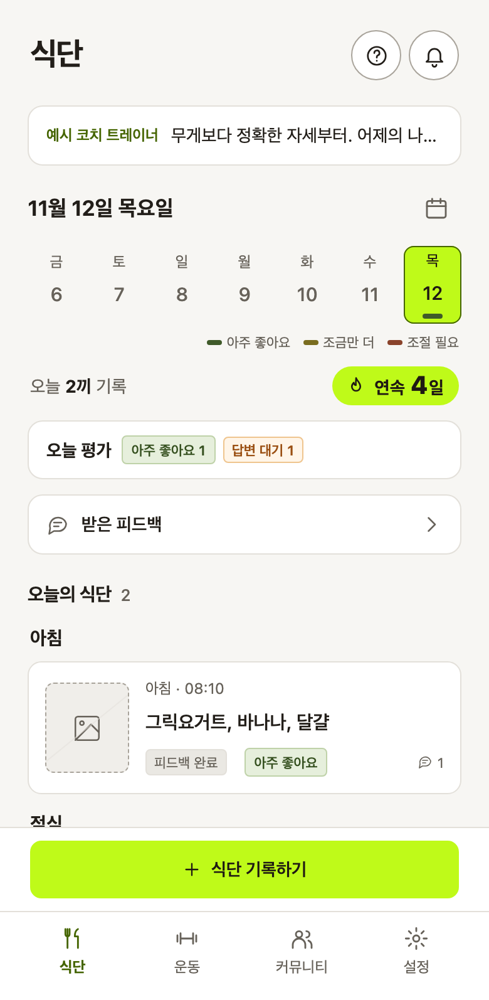
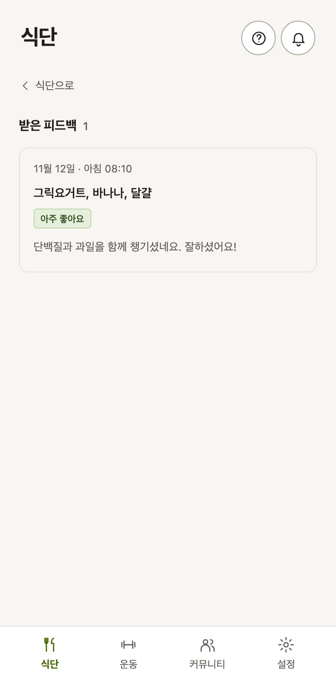
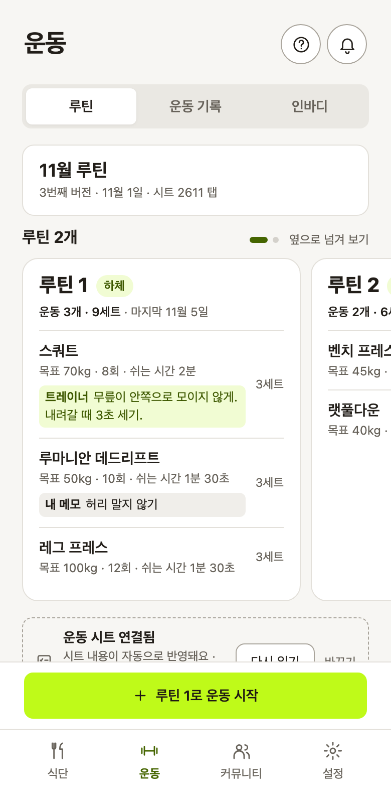
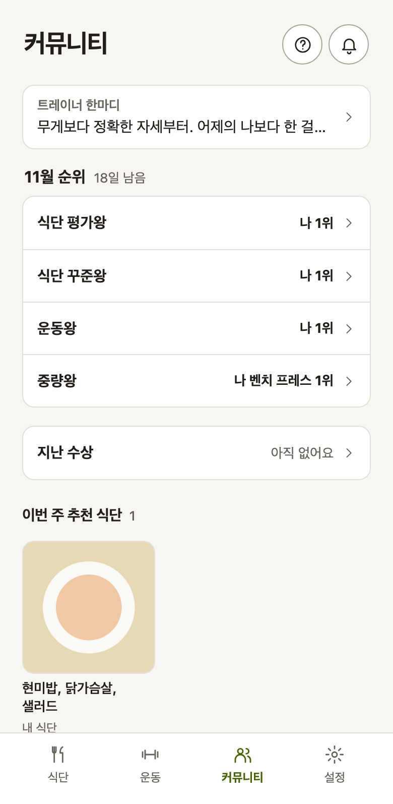
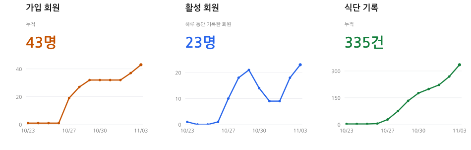
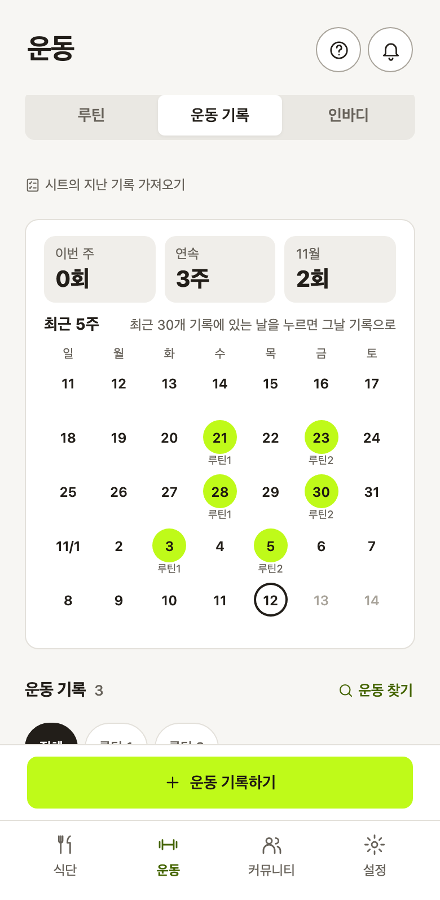
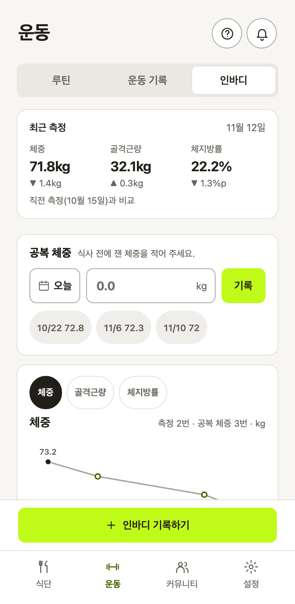
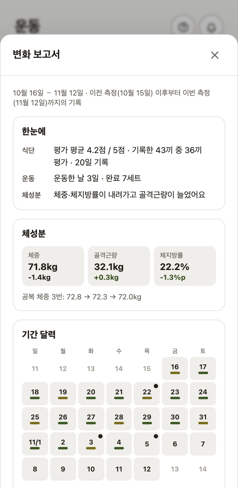

# FITORY — 회원의 식단·운동 기록과 트레이너의 코칭을 연결하는 앱

**FITORY는 제가 다니는 PT센터에서 트레이너와 회원들이 함께 쓰는 앱입니다.** 회원은 식단과 운동을 기록하고, 트레이너는 이를 확인해 피드백을 남깁니다. 운동 루틴부터 실제 수행, 인바디 변화까지 함께 보며 다음 계획을 정합니다. 커뮤니티에서는 추천 식단과 운동 팁을 나누고, 기록의 꾸준함과 운동 성과를 비교합니다.

원래는 식단 사진을 트레이너에게 카카오톡으로 보내는 방식이었습니다. 저도 식단 관리를 받고 싶었지만, 개인 카카오톡으로 사진을 보내는 게 부담스러워 잘 보내지 않았습니다. 트레이너도 비슷한 회원이 많다며 전용 앱을 제안했고, 제가 직접 만들어 보기로 했습니다.

어떤 기능부터 만들지, 회원과 트레이너가 어떻게 쓸지는 제가 정했습니다. Claude Code에 구현을, Codex에 계획과 코드 검토를 맡기고, 양쪽 화면을 직접 써 보며 고쳤습니다.

식단 기록에서 시작한 앱을 운동과 체성분 변화까지 연결했습니다. 트레이너가 쓰던 스프레드시트는 유지하고, 회원이 앱에서 남긴 기록을 코칭에 함께 활용하도록 구성했습니다.

## 1. 회원이 기록하고, 트레이너가 피드백하는 서비스

회원이 먹은 음식과 사진, 트레이너에게 묻고 싶은 내용을 남기면 담당 트레이너가 한 목록에서 확인합니다. 식사를 평가하거나 답글을 쓰면 회원의 식단 탭 안 ‘받은 피드백’에 모입니다. 대화는 해당 식사에 붙어 있어, 어떤 음식을 두고 나눈 이야기인지 함께 볼 수 있습니다.

| 회원이 하는 일 | 트레이너가 확인하는 것 |
|---|---|
| 식단과 질문을 기록하고 피드백 확인 | 아직 확인하지 않은 식사와 답변할 메시지 |
| 루틴을 보고 실제 중량·횟수·완료 세트 기록 | 새 운동 기록과 회원별 수행 내역 |
| 인바디·공복 체중을 기록하고 변화 확인 | 같은 기간의 식단·운동·체성분 변화와 총평 |
| 커뮤니티에서 내 순위·참여 조건·추천 식단 확인 | 추천 식단 선정, 운동 팁과 한마디 공유 |

회원은 **식단·운동·커뮤니티·설정**, 트레이너는 **확인·회원·커뮤니티·설정**으로 이동합니다. 아래는 현재 앱 코드에 가상의 회원·식사·운동 기록을 넣어 촬영한 화면입니다.

| 회원의 기록 | 트레이너의 확인 | 회원의 피드백 |
|---|---|---|
|  |  |  |

화면을 누르면 크게 볼 수 있습니다. 이름·사진·대화·측정값은 모두 설명용 예시입니다. 실제 사용 현황은 아래 집계 그래프에 따로 표시했습니다.

회원은 개인 메신저로 따로 말을 걸지 않고 식사를 남길 수 있습니다. 트레이너는 회원별 대화방을 오가는 대신, 아직 처리할 기록을 한곳에서 봅니다. 회원이 댓글을 추가하면 이미 확인한 식사도 다시 답변 대기 목록에 표시됩니다.

| 운동 루틴과 이전 수행 | 커뮤니티와 내 순위 | 트레이너의 회원 관리 |
|---|---|---|
|  |  |  |

### 실제 사용 현황

담당 트레이너와 제가 먼저 써 본 뒤, 센터의 다른 회원들도 사용하기 시작했습니다.

<!-- usage-metrics:start -->
<picture>
  <source media="(max-width: 600px)" srcset="docs/images/usage-mobile.svg">
  
</picture>

2026년 11월 11일까지의 기록입니다. 활성 회원은 그날 식단을 한 번 이상 작성한 회원이며, 가입 회원과 식단 기록은 누적입니다. 테스트 계정은 제외하고, 매일 전날까지 갱신합니다. [집계 기준](docs/reference/사용_현황_집계.md)
<!-- usage-metrics:end -->

## 2. 회원과 트레이너의 사용 방식에 맞춘 설계

### 제가 다니는 센터에 필요한 기능부터 만들었습니다

첫 기획안은 회원 100명 규모의 스토어 앱과 관리자 웹을 외주로 만드는 안이었습니다. 제가 다니는 센터의 트레이너와 회원들이 쓸 앱인데, 시작부터 규모가 너무 컸습니다. 저는 AI를 활용해 직접 개발하기로 하고, 식사를 기록하고 피드백을 주고받는 데 필요한 기능부터 추렸습니다.

칼로리 자동 분석·결제·별도 채팅방·센터 관리자 웹은 제외했습니다. 앱은 링크로 전달하고 휴대폰 홈 화면에 추가해 쓰는 모바일 웹앱(PWA)으로 정했습니다. 닉네임과 숫자 6자리 PIN으로 가입하고, 회원이 담당 트레이너를 직접 고르게 했습니다.

현재도 기록과 코칭에 필요한 범위를 중심으로 기능을 정합니다. 식단·운동·인바디를 연결하되, 트레이너의 판단을 대신하는 자동 처방이나 별도 채팅 서비스로 범위를 넓히지는 않았습니다. [제품 범위와 그 판단 근거](docs/01_문제와_범위_결정.md)

### 필수 입력을 먼저 보여주고, 기록에 필요한 조작을 줄였습니다

회원은 식단 등록 때 스크롤을 줄이고 사진 찍기와 앨범 선택을 나눠 달라고 했습니다. 시안을 보니 선택 사항인 사진이 맨 위를 차지하고, 정작 필수인 음식 이름은 가운데에 있었습니다. 저는 필수 칸이 먼저 보이도록 순서를 바꾸고, 날짜·시각·식사 구분은 미리 채우게 했습니다. 사진은 두 버튼으로 고르되 선택한 사진의 미리보기는 유지했습니다.

식단 첫 화면도 아침·점심·저녁·간식으로 나눴습니다. 비어 있는 끼니를 누르면 그 구분으로 입력 창이 열립니다. 운동에서는 루틴의 목표를 불러온 뒤 실제 중량·횟수와 완료 세트만 고칩니다. 이전 기록을 확인하거나 메모를 읽고 돌아와도 쓰던 내용은 남습니다.

| 필수 칸부터 입력하는 식단 등록 | 이전 중량과 메모를 보며 운동 기록 |
|---|---|
|  |  |

[회원 의견을 입력 방식으로 구체화한 과정](docs/06_개발_방식과_검토.md#회원-의견을-실제-사용-상황으로-구체화합니다)

### 식사 확인과 메시지 답변을 구분합니다

회원·트레이너 화면을 번갈아 써 보니, 중요한 질문을 놓치기 쉽고 답변이 필요 없는 메시지도 처리할 일로 남았습니다.

식사와 함께 등록한 메시지는 사진 아래 작은 회색 글씨로 보여 놓치기 쉬웠습니다. 그런데 마지막 메시지를 회원이 보냈으면 무조건 답변 대기에 남아, “감사합니다”에도 트레이너가 답글을 써야 목록에서 빠졌습니다.

저는 식사와 함께 등록한 메시지를 대화의 맨 위에 보여주고, 답변을 기다리는 식사를 목록 상단에 두게 했습니다. 답변할 필요가 없으면 트레이너가 ‘답변 없이 확인’을 눌러 정리할 수 있습니다. 이후 회원이 댓글을 추가하면 다시 답변 대기에 표시됩니다.

아래 화면처럼 회원이 “감사합니다”라고 남겼을 때, 트레이너는 답글을 쓰거나 확인만 할 수 있습니다.

확인 목록과 알림에도 같은 규칙을 적용해, 이미 처리한 메시지를 다시 답변 대기로 알리지 않게 했습니다. 트레이너 화면에는 회원의 새 운동 기록도 모아 보여주고, 회원별 식단·루틴·운동·인바디로 바로 이동할 수 있게 했습니다. [직접 써 보며 바꾼 과정과 현재 규칙](docs/02_트레이너_업무_흐름과_처리_규칙.md)

### 식단 평가는 피드백과 기간별 비교에 함께 씁니다

평가 버튼의 문구는 회원이 읽을 피드백이기도 합니다. 저는 잘 먹은 식사는 격려하고, 조절이 필요한 식사는 알려주는 말로 쓰고 싶었습니다. 그래서 “너무 좋다”, “좋은데 좀 더”, “신경 써 달라”의 세 가지 느낌을 전달했습니다.

AI가 이를 다듬은 문구가 현재의 ‘아주 좋아요’, ‘좋아요, 조금만 더’, ‘조절이 필요해요’입니다. 점수도 제가 5점 만점으로 정했습니다. 개별 식사에는 평가 문구를 보여주고, 두 인바디 측정 사이의 식단 평가를 모을 때는 각 평가를 5·3·1점으로 환산해 평균을 보여줍니다.

### 순위뿐 아니라 참여 조건과 공개 범위도 정했습니다

커뮤니티에는 식단 평가왕·꾸준왕·운동왕·중량왕을 뒀습니다. 순위가 높은 회원만 보이면 아직 조건을 채우지 못한 회원은 무엇을 더 기록할지 알기 어렵습니다. 저는 후보 전 회원도 내 순위와 남은 조건을 보게 하고, 수상 후보는 앞에 구분해 표시하도록 정했습니다. 지난달 결과와 이번 달 순위는 한 달 내내 확인할 수 있습니다.

중량왕은 벤치 프레스·데드리프트·스쿼트의 5회 세트만 비교합니다. 남녀를 나누고 절대 중량과 체중 대비 중량을 구분해, 다른 동작이나 횟수의 기록을 같은 기준으로 비교하지 않도록 했습니다. 식단 공유·닉네임 공개·성별 공개는 회원이 각각 선택합니다. 공유 식단에도 개인 질문과 댓글은 나오지 않습니다.

| 내 순위와 수상 후보 조건 | 동작·성별·중량 기준을 나눈 비교 |
|---|---|
|  |  |

[참여·비교·공개 규칙](docs/reference/FITORY_제품기획.md#커뮤니티와-참여-규칙)

### 알림은 트레이너에게 모아서, 회원에게 바로 보냅니다

트레이너는 여러 회원의 기록을 확인하고, 회원은 자신의 식사에 대한 피드백을 받습니다. 저는 두 사람에게 알리는 방식을 다르게 정했습니다.

트레이너에게는 회원이 기록할 때마다 보내지 않고, 확인할 일이 있을 때 하루 3회(선택하면 5회) 건수를 모아 보냅니다. 회원에게는 피드백을 남긴 직후 알립니다. 처음 계획은 피드백도 3분간 모아 보내는 방식이었지만, 구현 중에 바로 보내게 바꿨습니다.

기록 알림은 점심과 저녁을 따로 확인합니다. 그 끼니를 이미 남겼으면 보내지 않고, 회원이 받을 알림을 종류별로 고를 수 있게 했습니다. [알림을 보내는 때와 받는 사람의 선택](docs/04_알림_설계.md)

## 3. AI와 함께 개발한 방식

저는 요구사항과 우선순위를 정해 AI에 맡기고, 나온 결과를 직접 써 보며 다음에 바꿀 것을 정했습니다. 구현과 검토는 서로 다른 AI에 맡겼습니다.

| 담당 | 맡은 일 |
|---|---|
| 저 | 요구사항과 제품 기획, 제안의 채택·수정, 사용 점검, 출시 결정 |
| Claude Code | 기획에 따른 구현, 검증과 배포, 변경 기록 |
| Codex | 계획·코드 검토, 문제 재현, 대안 제안 |

### 검토 의견을 보고 계정 복구 방식을 다시 기획했습니다

초기 앱에서는 PIN을 잊은 회원에게 담당 트레이너가 새 PIN을 정해 줬습니다. 이메일이나 전화번호를 받지 않으니 인증 메일·문자를 쓸 수 없어 택한 방식이었습니다. Codex는 이 권한으로 트레이너가 회원 계정에 직접 로그인할 수도 있다고 지적했습니다.

저는 이 지적과 Codex가 제안한 아이디어를 보고, 연락처 없이도 회원이 직접 계정을 되찾는 절차를 기획했습니다. 가입할 때 복구 질문과 답을 정해 두고, PIN을 잊으면 그 질문에 답해 새 PIN을 설정하게 했습니다. 질문은 좋아하는 영화나 노래처럼 식단 기록만으로는 짐작하기 어려운 취향에 관한 것으로 골랐습니다.

누군가 PIN을 바꾼 경우에는 기존에 로그인해 둔 기기로 알리고, 본인이 한 변경이 아니면 그 기기에서 계정을 되찾게 했습니다. 트레이너가 회원의 PIN을 대신 정하는 기능은 없앴습니다.

이 기획을 Claude Code에 구현하게 한 뒤 Codex에 재검토를 맡겼습니다. 재검토에서는 복구 도중 다른 요청이 들어오면 잘못된 변경을 허용할 수 있는 경우까지 찾아 보완했습니다. [복구 절차와 검토에서 보완한 내용](docs/03_가입과_계정_보안.md)

### 화면과 알림이 같은 규칙을 쓰는지 검토하게 했습니다

기능을 하나씩 추가하다 보면 같은 일을 화면과 알림에서 다르게 처리할 수 있습니다. 예를 들어 트레이너가 ‘답변 없이 확인’한 메시지를 알림에서는 여전히 답변 대기로 셀 수 있습니다.

저는 리뷰 기준을 요청하면서 새 기능이 기존 앱과 같은 규칙을 쓰는지, 다음 변경 때에도 고치기 쉬운지 함께 검토하게 했습니다. 운동 기록도 목록·상세·보고서에서 같은 값을 사용하고, 시트 반영에 실패해도 앱에 저장한 기록은 남도록 합니다. Codex가 문제를 재현하고, Claude Code가 수정한 뒤 같은 조건에서 다시 확인합니다. [개발 방식과 검토](docs/06_개발_방식과_검토.md)

## 4. 운동과 식단을 함께 보고 다음 목표를 정합니다

| 주별 운동 기록과 날짜별 탐색 | 공복 체중과 인바디 변화 | 같은 기간의 변화 보고서 |
|---|---|---|
|  |  |  |

제가 다니는 센터의 트레이너는 구글 스프레드시트에 운동 루틴을 짜 줍니다. 이 작성 방식을 유지하면서 회원은 FITORY에서 루틴을 확인하고 실제 수행을 기록합니다. 앱에 남긴 수행 기록은 연결된 시트에도 반영합니다. 트레이너가 직접 적거나 고친 값은 덮어쓰지 않도록 했습니다. 시트에 있던 과거 기록도 가져오며, 연결 과정은 주소 복사·링크 붙여 넣기·연결하기의 세 단계와 그림으로 안내합니다.

운동 중에는 계획된 중량과 횟수뿐 아니라 해당 운동을 마지막으로 한 날짜와 기록도 함께 봅니다. 이전 기록을 확인하러 이동해도 작성 중인 입력은 유지됩니다. 새 운동 기록에는 최근 수행한 중량을 참고하고, 동작별 메모는 루틴이 바뀌어도 이어집니다. 트레이너의 설명과 회원 자신의 메모는 칸을 나눠 서로 덮어쓰지 않습니다.

인바디 변화 보고서는 **두 측정 사이의 같은 기간**을 기준으로 식단 평가, 운동 횟수와 중량 변화, 체성분 변화를 함께 보여줍니다. 트레이너는 이 자료에 총평을 남깁니다. 운동 계획을 받았다는 것과 실제로 수행했다는 것을 구분하고, 기록된 변화와 그 원인에 대한 해석도 나눴습니다. 회원과 트레이너가 함께 기록을 읽고 다음 계획을 논의할 수 있도록 한 것입니다.

[루틴·수행 기록·변화 보고서를 연결한 설계](docs/07_앞으로의_계획.md)

## 5. 설계 기록과 구현 자료

현재 기능·화면 이동·입력·권한·참여 규칙은 [FITORY 제품 기획](docs/reference/FITORY_제품기획.md)에 정리했습니다. 아래 상세 문서는 이 구성을 선택한 이유와 대표 사례를 설명합니다.

| 더 살펴볼 내용 | 문서 |
|---|---|
| 무엇부터 만들기로 했는가 | [문제와 범위 결정](docs/01_문제와_범위_결정.md) |
| 확인과 답변을 왜 나눴는가 | [트레이너 업무 흐름과 처리 규칙](docs/02_트레이너_업무_흐름과_처리_규칙.md) |
| 가입 편의와 계정 권한을 어떻게 다뤘는가 | [가입과 계정 보안](docs/03_가입과_계정_보안.md) |
| 누구에게 언제 알릴 것인가 | [알림 설계](docs/04_알림_설계.md) |
| 실제 사용 중인 앱을 어떻게 고쳤는가 | [출시 후 운영](docs/05_출시_후_운영.md) |
| AI와 어떻게 일을 나눴는가 | [개발 방식과 검토](docs/06_개발_방식과_검토.md) |
| 운동·식단·인바디를 어떻게 함께 볼 것인가 | [운동·식단·인바디 연결](docs/07_앞으로의_계획.md) |

코드는 React·Vite, Supabase, Cloudflare Pages를 사용합니다. 기술 구성과 실행·검증 방법은 [운영 안내](docs/운영_안내.md)에, 현재 제품 기획과 초기 기획안·검토 자료는 [참고 자료](docs/reference/)에 있습니다.

### 저장소 구성과 공개 범위

| 경로 | 내용 |
|---|---|
| `docs/` | 현재 기능과 설계 판단, 화면, 실행 안내 |
| `docs/reference/` | 현재 제품 기획과 초기 기획안·화면 시안·검토 자료 |
| `src/` | 회원·트레이너 화면과 앱의 처리 규칙 |
| `supabase/` | 데이터 구조·권한 규칙·서버 기능 |
| `scripts/` | 검증·개발 환경·배포 도구 |

문서에는 현재 제품의 사용 흐름과 설계 판단을 담았습니다. 기획 원문과 공개용으로 정리한 구현·검토 자료를 함께 연결했습니다.

실제 사용자의 기록·사진·실명, 운영 주소와 프로젝트 식별자는 포함하지 않았습니다. 사용 현황은 집계 수치만 싣고, 식단과 대화 화면은 예시 데이터로 재현했습니다. 코드의 `https://mealnote.example`은 자리표시자이며 등록 코드 해시도 예시 값입니다.

참고 자료는 경로·실명·운영 주소를 정제한 원문입니다. Codex가 검토에 쓴 별도 재현 스크립트는 포함하지 않았습니다. 라이선스는 두지 않았으며, 열람을 위해 올린 자료로 코드 재사용을 허용한 것은 아닙니다.

Summary in English

FITORY is a meal and workout logging app used at the personal-training studio I attend. My trainer suggested a dedicated app because members were reluctant to send meal photos through personal messaging. I was one of those members.

I defined the scope and product rules, tested both member and trainer workflows, and decided what to change and when to release. Claude Code implemented the app; Codex reviewed plans and code.

I separated meal review from message replies so trainers could acknowledge a message without writing back. After reviewing ideas from Codex, I also planned a self-service account recovery flow: members can reset a forgotten PIN without sharing contact details or asking a trainer to set a new one.

<!-- usage-metrics-en:start -->
Through November 11, 2026 (KST), the app had 47 registered members and 673 meal records. On that day, 16 members logged at least one meal. Test accounts are excluded; the charts update daily after the Korean day ends.
<!-- usage-metrics-en:end -->

FITORY connects trainers' Google Sheets routines with members' workout logs. Members can check previous sets and keep exercise-specific notes across routines; syncing respects values entered directly in the sheet. Reports bring meal feedback, workout records and body-composition changes into the same measurement period, with a separate trainer assessment.

This repository presents the product decisions and selected implementation materials. Community features include meal and workout awards, transparent eligibility rules, and separate sharing choices. The screenshots show the current app with fictional data. Individual user records and production identifiers are excluded.

