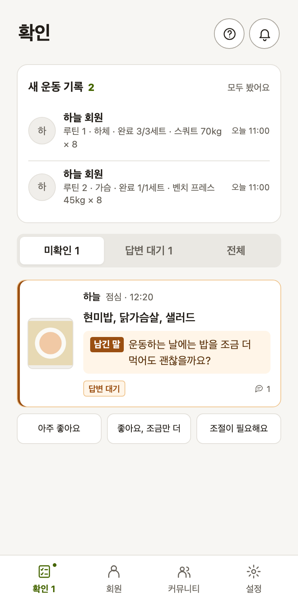
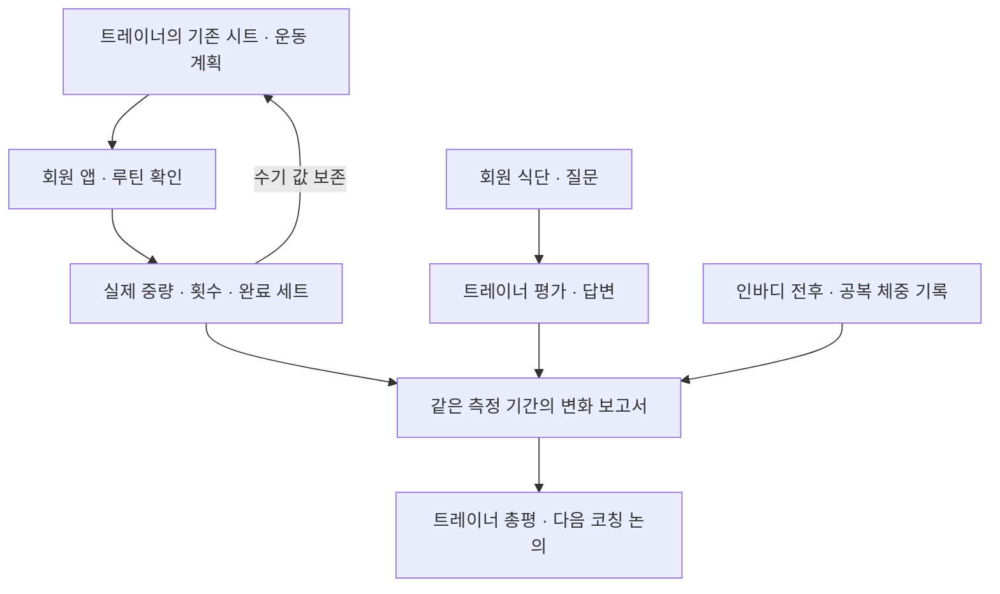
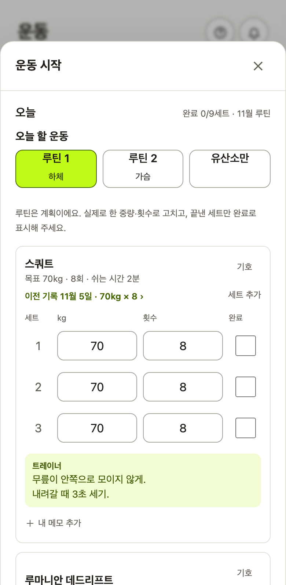
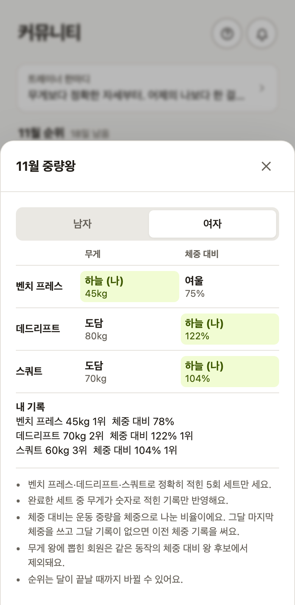
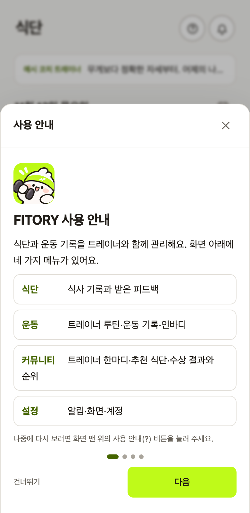
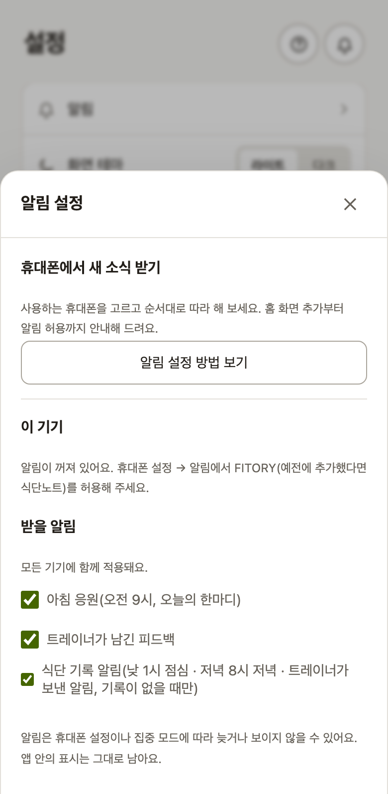

# FITORY — 회원의 식단·운동 기록과 트레이너의 코칭을 연결하는 앱

**제가 다니는 PT센터에서 트레이너와 회원들이 함께 쓰는 모바일 웹앱입니다.** 트레이너는 쓰던 Google Sheets에서 운동 루틴을 작성하고, 회원은 앱에서 계획을 보며 실제 수행과 식단을 남깁니다. 두 인바디 측정 사이의 같은 기간으로 기록을 묶은 변화 보고서에 트레이너가 총평을 더해 다음 코칭에 활용합니다.

개인 카카오톡으로 식단 사진을 보내기 부담스러워하던 문제에서 출발했습니다. 저도 그런 회원 중 하나였고, 트레이너의 전용 앱 제안을 받아 제품 범위·사용 흐름·참여 정책·출시 시점을 정했습니다. Claude Code에 구현을, Codex에 계획과 코드 검토를 맡기고 두 역할의 화면을 직접 써 보며 개선했습니다.

회원은 자신의 식단과 피드백을 보고, 트레이너는 여러 회원의 새 기록과 답변할 질문을 모아 봅니다. 아래 화면은 **공개 앱 코드에 가상의 이름·식단·운동·측정값을 넣어 촬영한 화면**입니다. 이미지를 누르면 원본을 크게 볼 수 있습니다.

| 회원 · 오늘의 기록과 받은 피드백 | 트레이너 · 확인할 기록과 질문 |
|---|---|
|  |  |
| 날짜별 식단과 평가를 확인하고 새 식사를 남깁니다. | 새 운동 기록과 식단을 확인하고, 질문이 있는 식사부터 살펴봅니다. |

## 1. 기존 시트에서 다음 코칭까지 이어지는 흐름

앱은 계획과 실제 수행을 구분하고, 보고서는 식단·운동·체성분을 같은 기간에 맞춥니다. 트레이너의 총평은 그 자료에 대한 해석입니다. 마지막 단계는 두 사람이 다음 계획을 논의하는 과정이며 자동 운동 처방은 아닙니다.

회원은 **식단·운동·커뮤니티·설정**, 트레이너는 **확인·회원·커뮤니티·설정**으로 이동합니다. 회원은 자신의 기록을, 트레이너는 처리할 일과 담당 회원을 중심으로 봅니다.

### 실제 사용 현황

담당 트레이너와 제가 먼저 써 본 뒤 센터의 다른 회원들도 사용하기 시작했습니다. 아래는 가입·식단 기록의 집계이며, 화면에 쓰인 예시 데이터와 구분합니다.

<!-- usage-metrics:start -->
<picture>
  <source media="(max-width: 600px)" srcset="docs/images/usage-mobile.svg">
  
</picture>

2026년 11월 13일까지의 기록입니다. 활성 회원은 그날 식단을 한 번 이상 작성한 회원이며, 가입 회원과 식단 기록은 누적입니다. 테스트 계정은 제외하고, 매일 전날까지 갱신합니다. [집계 기준](docs/reference/사용_현황_집계.md)
<!-- usage-metrics:end -->

가입 회원은 활성 사용자와 다릅니다. 집계는 현재 남은 데이터로 다시 계산하므로 계정·기록 삭제 등에 따라 과거 수치도 바뀔 수 있습니다. 이 수치는 운영 규모의 근거이며 기획 변경이 참여율·유지율을 높였다는 인과 근거는 아닙니다.

### 기록이 코칭 자료가 되는 장면

운동 중 남긴 수행 기록과 식단은 같은 측정 기간의 보고서에서 함께 확인합니다.

| 계획을 보고 실제 수행 기록 | 같은 기간의 식단·운동·변화 |
|---|---|
|  |  |
| 지난 중량과 트레이너 메모를 참고해 완료한 세트를 남깁니다. | 식단·운동을 기록한 날과 체성분 변화를 같은 기간으로 살펴봅니다. |

[식단과 피드백 화면](docs/02_트레이너_업무_흐름과_처리_규칙.md) · [루틴·시트 연결·트레이너 총평 화면](docs/07_운동기록과_코칭보고서.md)

## 2. 제품의 범위와 사용 방식을 정한 네 가지 판단

### 직접 만들고 운영할 수 있는 범위로 기획했습니다

제가 다니는 센터에서 실제로 쓸 수 있도록, 직접 만들고 운영할 수 있는 범위로 기획했습니다. 회원의 식사 기록과 트레이너의 피드백을 먼저 연결하기로 했습니다. 칼로리 자동 분석·결제·별도 채팅방·센터 관리자 웹은 빼고, 링크로 접속해 홈 화면에 추가하는 PWA를 택했습니다.

닉네임·6자리 PIN으로 가입하고 회원이 담당 트레이너를 고르게 했습니다. 이후 운동·인바디·커뮤니티로 확장할 때도 기록을 코칭에 쓰는 목적을 유지했습니다. [범위와 선택 기준](docs/01_문제와_범위_결정.md)

### 트레이너의 시트 작성 방식과 회원의 실제 수행을 연결했습니다

트레이너가 이미 쓰던 시트의 루틴을 가져와 회원이 운동 중 확인하게 했습니다. 받은 목표를 운동 실적으로 세지 않고, 실제 중량·횟수·완료 세트를 따로 기록해 시트의 해당 회차에도 반영합니다. `20+5` 같은 현장 표기를 합계 25로 바꾸지 않으며, 트레이너가 직접 적거나 고친 칸을 앱 값으로 덮어쓰지 않습니다. 시트 반영이 실패해도 앱 기록은 남습니다.

‘운동 검색’ 요청은 운동 중 참고와 운동 밖 전체 조회로 나눴습니다. 운동 중에는 지난 날짜와 가장 무거운 세트를 먼저 보여주고, 상세 이력을 열었다 돌아와도 입력 중인 세트를 유지합니다. 메모는 날짜가 아닌 운동에 연결해 다음 루틴에도 쓰고, 회원·트레이너 칸을 나눴습니다. [연계 동작과 예외](docs/07_운동기록과_코칭보고서.md) · [대안과 제 선택](docs/06_개발_방식과_검토.md#회원-의견을-실제-사용-상황으로-구체화합니다)

### 같은 기간을 비교하고, 해석은 트레이너가 남깁니다

인바디 변화만 보면 그사이 무엇을 했는지 설명하기 어렵습니다. 저는 변화 카드에서 자세한 보고서를 열도록 요청하고, 회원과 트레이너가 같은 자료를 보도록 범위를 정했습니다. **직전 측정 다음 날부터 이번 측정일까지** 식단 평가와 기록 수, 운동 수행, 체성분 전후를 묶고 총평을 더했습니다.

평가받은 식단과 전체 기록, 계획과 완료 세트를 구분합니다. 기록이 없는 날을 미실천으로 단정하지 않고, 수치가 함께 변했다고 원인을 자동 판정하지 않습니다. 기록이 설명하는 범위를 정해야 다음 코칭의 자료로 쓸 수 있기 때문입니다. [보고서의 지표·기간·총평과 코드](docs/07_운동기록과_코칭보고서.md#3-인바디-측정-사이의-운동과-식단을-보고서로-정리합니다)

### 참여 조건·비교 기준·공개 범위를 함께 정했습니다

상위 회원만 보여주면 후보가 아닌 회원은 무엇을 더 해야 하는지 알기 어렵습니다. 저는 후보 전 회원도 내 순위와 남은 기록·평가 수를 보게 했습니다. 수상 후보는 앞에 구분하고 지난달 결과와 이번 달 순위는 한 달 내내 확인하게 했습니다.

중량왕은 같은 트레이너의 회원 중 3대 운동의 5회 완료 세트를 성별·절대 중량·체중 대비로 나눠 비교합니다. 같은 종목의 절대 중량왕과 체중 대비왕을 겸하지 못하게 한 것은 제 결정입니다. 한 사람의 중량과 비율이 함께 보이면 체중을 역산할 수 있기 때문입니다. 식단 공유·닉네임·성별 공개는 따로 선택하고, 공개 식단에서는 개인 질문과 댓글을 제외합니다. [후보 조건·비교·공개 정책과 SQL](docs/08_참여_비교_공개정책.md)

| 커뮤니티 · 현재 순위와 추천 식단 | 중량왕 · 비교 기준과 내 기록 |
|---|---|
|  |  |
| 순위 요약에서 상세로 들어가고, 공유된 추천 식단을 볼 수 있습니다. | 같은 동작에서도 절대 중량과 체중 대비를 나눠 보여줍니다. |

## 3. 기록과 피드백이 끊기지 않게 운영합니다

**확인과 답변을 나눴습니다.** 식사와 함께 적은 질문은 대화 첫 메시지로 보여주고, 답변 대기를 위에 둡니다. ‘감사합니다’에는 답글 없이 확인만 할 수 있으며, 이후 새 메시지나 수정된 질문이 오면 다시 대기로 표시합니다. 식단 평가 문구의 세 가지 느낌과 5점 만점 기준은 제가 정했고 AI가 문구를 다듬었습니다. [상태·평가·화면 근거](docs/02_트레이너_업무_흐름과_처리_규칙.md)

**알림은 역할에 맞췄습니다.** 트레이너에게는 처리할 일을 하루 3회 또는 5회로 모으고, 회원에게는 피드백 저장 직후 발송을 요청합니다. 보내기 전 이미 처리한 일은 제외합니다. 즉시 요청과 10분 정기 점검이 함께 있으며 휴대폰 도착 시간을 보장하는 의미는 아닙니다. [발송 조건과 호출 경로](docs/04_알림_설계.md)

**검토 의견으로 권한을 바꿨습니다.** Codex가 트레이너의 PIN 재설정 권한으로 회원 계정에 접근할 위험을 지적했습니다. 저는 연락처 없는 가입을 유지하면서 복구 질문과 기존 로그인 기기로 회원이 직접 계정을 되찾는 절차를 재기획했습니다. [가입·복구와 예외](docs/03_가입과_계정_보안.md)

**입력과 기존 기록을 보호합니다.** 자동 업데이트, 운동 이력 조회, 계정 전환과 시트 반영이 작성 중인 내용이나 다른 사람의 기록을 지우지 않도록 검토합니다. 기능이 동작하는지와 화면·알림·보고서가 같은 규칙을 쓰는지를 함께 봅니다. [운영 기준](docs/05_출시_후_운영.md)

앱 안에는 처음 사용하는 회원을 위한 사용 안내와 휴대폰별 알림 설정 안내도 마련했습니다.

| 시작할 때 · 네 가지 메뉴 안내 | 사용 중 · 받을 알림과 기기 상태 |
|---|---|
|  |  |
| 회원이 기록·피드백·운동·설정을 어디서 찾는지 안내합니다. | 이 기기의 알림 상태와 모든 기기에 적용할 수신 항목을 구분합니다. |

## 4. 제가 맡은 판단과 AI의 구현·검토

| 담당 | 맡은 일 |
|---|---|
| 저 | 제품 범위·우선순위·사용 규칙, 시안과 대안의 선택·수정, 실사용 점검, 출시 결정 |
| Claude Code | 기획에 따른 구현, 검증·배포, 변경 기록 |
| Codex | 계획·코드 검토, 결함 재현과 대안 제안, 일부 안내 콘텐츠 |

예를 들어 식단 입력 시안에서 선택 사진이 필수 음식명보다 먼저 나오는 문제를 제가 지적해 순서를 바꿨습니다. 반면 운동 검색의 상세 방식과 메모의 여러 선택지는 AI가 제안했고 제가 비교해 채택했습니다. [요구·대안·선택·구현의 구체적인 과정](docs/06_개발_방식과_검토.md)

## 5. 상세 설계와 구현 자료

| 읽을 주제 | 문서 |
|---|---|
| 실제 센터에 맞춘 범위와 제외한 기능 | [01 문제와 범위](docs/01_문제와_범위_결정.md) |
| 식사 확인·평가·답변의 상태 | [02 트레이너 업무 흐름](docs/02_트레이너_업무_흐름과_처리_규칙.md) |
| 연락처 없는 가입과 회원 주도 복구 | [03 가입과 계정 보안](docs/03_가입과_계정_보안.md) |
| 역할별 알림과 이미 처리한 알림 취소 | [04 알림](docs/04_알림_설계.md) |
| 입력·기록 보존과 출시 검증 | [05 운영](docs/05_출시_후_운영.md) |
| 대안 선택·AI 협업·검토 방식 | [06 개발 방식과 검토](docs/06_개발_방식과_검토.md) |
| 기존 시트·실제 수행·같은 기간 보고서 | [07 운동 기록과 코칭 보고서](docs/07_운동기록과_코칭보고서.md) |
| 후보·비교 대상·정보 공개 기준 | [08 참여·비교·공개 정책](docs/08_참여_비교_공개정책.md) |

전체 기능은 [제품기획 색인](docs/reference/FITORY_제품기획.md), 기술 구성과 실행 방법은 [운영 안내](docs/운영_안내.md)에 있습니다. React·Vite 화면은 `src/`, 데이터·권한·서버 처리는 `supabase/`, 검증·운영 도구는 `scripts/`에 있습니다. 초기안·검토 기록은 [참고 자료](docs/reference/)에 보존했습니다.

설명은 공개된 2.0~2.4 구현을 기준으로 합니다. 다음 달 루틴 자동 작성과 다중 사진 검토안은 현재 성과에 포함하지 않았습니다. 실제 사용자 기록·사진·실명·운영 주소·프로젝트 식별자는 제외했으며, `https://mealnote.example` 등은 자리표시자입니다. 공개 자료는 열람용이고 별도의 코드 재사용 라이선스는 두지 않았습니다.

Summary in English

FITORY is a mobile web app used at the personal-training studio I attend. It connects trainers' existing Google Sheets routines with members' actual workout and meal records, reports for the same body-composition measurement period, and a separate trainer assessment for the next coaching discussion. It began with members' reluctance to send meal photos through personal messaging.

I defined the scope, product rules, priorities and release decisions. Claude Code implemented the app; Codex reviewed plans and code. I planned a PWA within the scope I could build and operate for my studio, starting with meal records and trainer feedback. As the app expanded, I preserved trainers' sheet workflow and separated planned workouts from completed sets. Sheet sync respects manually edited values and keeps app records even when syncing fails. Exercise history and separate member/trainer notes are available during workouts and carry across routines.

Reports run from the day after the previous body-composition measurement through the current measurement date. Missing records are not treated as non-adherence, and simultaneous changes are not automatically assigned a cause. Community features show remaining eligibility requirements, compare five-repetition sets under defined conditions, and offer separate meal, nickname and gender sharing choices. For each lift, the absolute-weight winner cannot also win the bodyweight-relative award, reducing direct bodyweight inference from displaying both values.

In-app guides introduce the main menus and explain phone notification setup. Meal review and message acknowledgement are separate. Trainers receive grouped reminders; member feedback triggers a prompt delivery request alongside periodic checks. After Codex identified an account-access risk, I redesigned recovery so members could recover their own accounts without contact details.

<!-- usage-metrics-en:start -->
Through November 13, 2026 (KST), the app had 47 registered members and 754 meal records. On that day, 13 members logged at least one meal. Test accounts are excluded; the charts update daily after the Korean day ends.
<!-- usage-metrics-en:end -->

These counts show usage, not measured growth or retention caused by product changes. Screenshots use fictional data. Documentation covers the published 2.0–2.4 implementation; automatic next-month routines and the multiple-photo proposal are excluded. Individual user records and production identifiers are not published.

