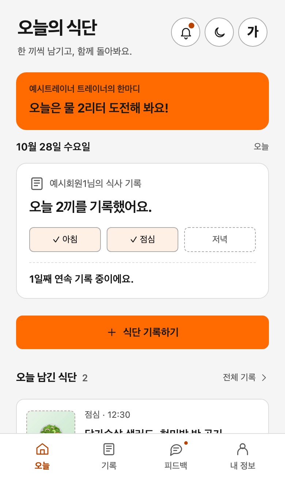
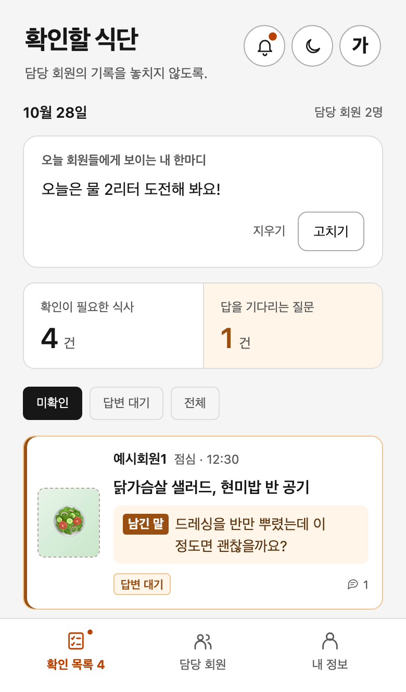
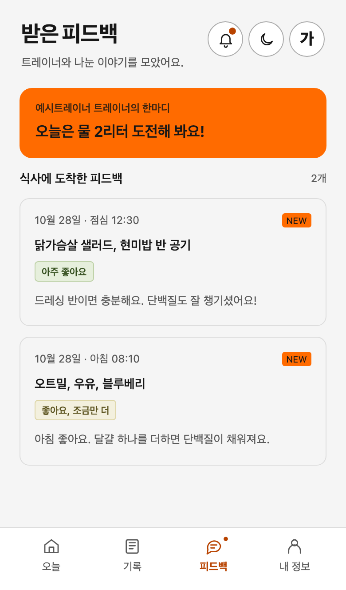
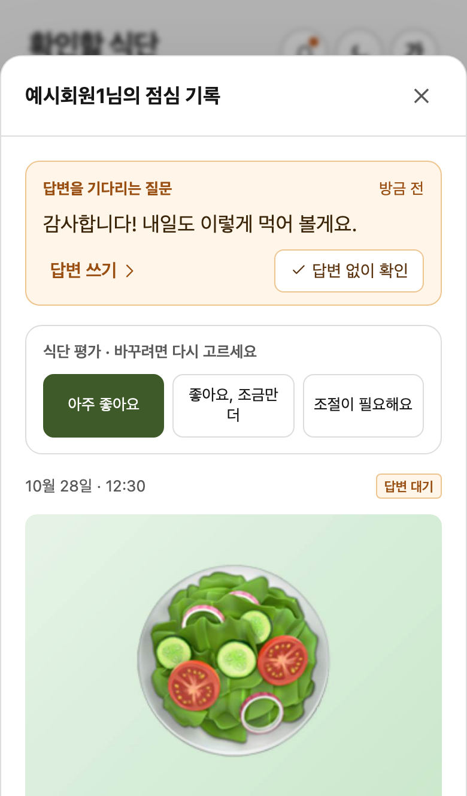
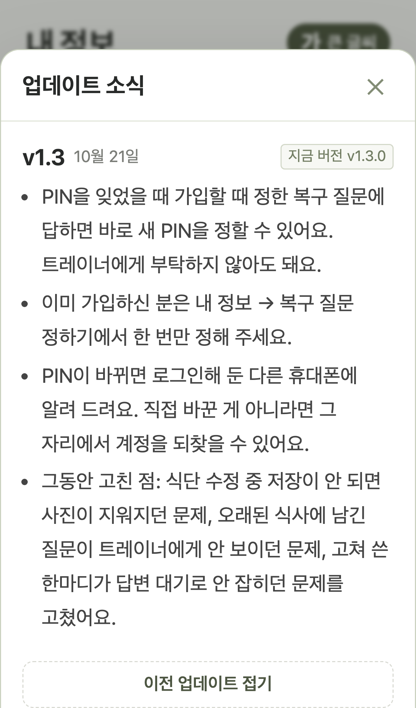

# 식단노트 — 직접 기획하고 운영하는 식단 관리 앱

**식단노트는 제가 다니는 PT센터에서 트레이너와 회원들이 함께 쓰는 앱입니다.** 회원이 식사를 기록하면 담당 트레이너가 확인하고 피드백을 남깁니다.

원래는 식단 사진을 트레이너에게 카카오톡으로 보내는 방식이었습니다. 저도 식단 관리를 받고 싶었지만, 개인 카카오톡으로 사진을 보내는 게 부담스러워 잘 보내지 않았습니다. 트레이너도 비슷한 회원이 많다며 전용 앱을 제안했고, 제가 직접 만들어 보기로 했습니다.

어떤 기능부터 만들지, 회원과 트레이너가 어떻게 쓸지는 제가 정했습니다. Claude Code에 구현을, Codex에 계획과 코드 검토를 맡기고, 양쪽 화면을 직접 써 보며 고쳤습니다.

앱에서 안내한 [실제 업데이트 내역](#app-updates)도 아래에서 볼 수 있습니다.

## 1. 회원이 기록하고, 트레이너가 피드백하는 서비스

회원이 먹은 음식과 사진, 트레이너에게 묻고 싶은 내용을 남기면 담당 트레이너가 한 목록에서 확인합니다. 식사를 평가하거나 답글을 쓰면 회원의 피드백 화면에 모입니다. 대화는 해당 식사에 붙어 있어, 어떤 음식을 두고 나눈 이야기인지 함께 볼 수 있습니다.

회원이 식사를 남긴 뒤 피드백을 받기까지의 과정입니다.

| 회원의 기록 | 트레이너의 확인 | 회원의 피드백 |
|---|---|---|
|  |  |  |

화면을 누르면 크게 볼 수 있습니다. 로컬 DB의 예시 계정으로 재현한 화면이며, 실제 회원의 사진과 대화는 포함하지 않았습니다.

회원은 개인 메신저로 따로 말을 걸지 않고 식사를 남길 수 있습니다. 트레이너는 회원별 대화방을 오가는 대신, 아직 처리할 기록을 한곳에서 봅니다. 회원이 댓글을 추가하면 이미 확인한 식사도 다시 답변 대기 목록에 표시됩니다.

### 실제 사용 현황

담당 트레이너와 제가 먼저 써 본 뒤, 센터의 다른 회원들도 사용하기 시작했습니다.

| 항목 | 사용 현황 |
|---|---|
| 가입 | 트레이너 2명, 회원 29명 |
| 식사 기록 | 회원 23명이 105건 기록 |
| 트레이너 피드백 | 식사 71건 확인·평가, 답글 33개 |

2026년 10월 29일 17시 기준입니다. 식사 기록과 피드백은 10월 27일부터 집계했으며, 테스트 계정은 제외했습니다.

## 2. 회원과 트레이너의 사용 방식에 맞춘 설계

### 제가 다니는 센터에 필요한 기능부터 만들었습니다

첫 기획안은 회원 100명 규모의 스토어 앱과 관리자 웹을 외주로 만드는 안이었습니다. 제가 다니는 센터의 트레이너와 회원들이 쓸 앱인데, 시작부터 규모가 너무 컸습니다. 저는 AI를 활용해 직접 개발하기로 하고, 식사를 기록하고 피드백을 주고받는 데 필요한 기능부터 추렸습니다.

칼로리 자동 분석·결제·별도 채팅방·센터 관리자 웹은 제외했습니다. 앱은 링크로 전달하고 휴대폰 홈 화면에 추가해 쓰는 모바일 웹앱(PWA)으로 정했습니다. 닉네임과 숫자 6자리 PIN으로 가입하고, 회원이 담당 트레이너를 직접 고르게 했습니다.

식단 기록과 피드백부터 쓸 수 있게 만든 뒤, 인바디 기록과 알림을 추가했습니다. [기획안 세 판에서 남긴 것과 뺀 것](docs/01_문제와_범위_결정.md)

### 식사 확인과 메시지 답변을 구분했습니다

트레이너가 회원의 질문을 놓치지 않으면서 필요한 답변에 집중할 수 있어야 했습니다. 회원·트레이너 화면을 번갈아 써 보니, 두 가지가 모두 불편했습니다.

식사와 함께 등록한 메시지는 사진 아래 작은 회색 글씨로 보여 놓치기 쉬웠습니다. 그런데 마지막 메시지를 회원이 보냈으면 무조건 답변 대기에 남아, “감사합니다”에도 트레이너가 답글을 써야 목록에서 빠졌습니다.

저는 식사와 함께 등록한 메시지를 대화의 맨 위에 보여주고, 답변을 기다리는 식사를 목록 상단에 두게 했습니다. 답변할 필요가 없으면 트레이너가 ‘답변 없이 확인’을 눌러 정리할 수 있습니다. 이후 회원이 댓글을 추가하면 다시 답변 대기에 표시됩니다.

아래 화면처럼 회원이 “감사합니다”라고 남겼을 때, 트레이너는 답글을 쓰거나 확인만 할 수 있습니다.

확인 목록과 알림에도 같은 규칙을 적용해, 이미 처리한 메시지를 다시 답변 대기로 알리지 않게 했습니다. [직접 써 보며 바꾼 과정과 현재 규칙](docs/02_트레이너_업무_흐름과_처리_규칙.md)

### 식단 평가의 문구와 점수도 직접 정했습니다

평가 버튼의 문구는 회원이 읽을 피드백이기도 합니다. 저는 잘 먹은 식사는 격려하고, 조절이 필요한 식사는 알려주는 말로 쓰고 싶었습니다. 그래서 “너무 좋다”, “좋은데 좀 더”, “신경 써 달라”의 세 가지 느낌을 전달했습니다.

AI가 이를 다듬은 문구가 현재의 ‘아주 좋아요’, ‘좋아요, 조금만 더’, ‘조절이 필요해요’입니다. 점수도 제가 5점 만점으로 정했습니다. 개별 식사에는 평가 문구를 보여주고, 두 인바디 측정 사이의 식단 평가를 모을 때는 각 평가를 5·3·1점으로 환산해 평균을 보여줍니다.

### 알림은 트레이너에게 모아서, 회원에게 바로 보냅니다

트레이너는 여러 회원의 기록을 확인하고, 회원은 자신의 식사에 대한 피드백을 받습니다. 저는 두 사람에게 알리는 방식을 다르게 정했습니다.

트레이너에게는 회원이 기록할 때마다 보내지 않고, 확인할 일이 있을 때 하루 3회(선택하면 5회) 건수를 모아 보냅니다. 회원에게는 피드백을 남긴 직후 알립니다. 처음 계획은 피드백도 3분간 모아 보내는 방식이었지만, 구현 중에 바로 보내게 바꿨습니다.

기록 알림은 점심과 저녁을 따로 확인합니다. 그 끼니를 이미 남겼으면 보내지 않고, 회원이 받을 알림을 종류별로 고를 수 있게 했습니다. [알림을 보내는 때와 받는 사람의 선택](docs/04_알림_설계.md)

## 3. AI와 함께 개발한 방식

저는 요구사항과 우선순위를 정해 AI에 맡기고, 나온 결과를 직접 써 보며 다음에 바꿀 것을 정했습니다. 구현과 검토는 서로 다른 AI에 맡겼습니다.

| 담당 | 맡은 일 |
|---|---|
| 저 | 요구사항과 제품 기획, 제안의 채택·수정, 사용 점검, 출시 결정 |
| Claude Code | 기획에 따른 구현, 검증과 배포, 변경 기록 |
| Codex | 계획·코드 검토, 문제 재현, 대안 제안 |

### 검토 의견을 보고 계정 복구 방식을 다시 기획했습니다

초기 앱에서는 PIN을 잊은 회원에게 담당 트레이너가 새 PIN을 정해 줬습니다. 이메일이나 전화번호를 받지 않으니 인증 메일·문자를 쓸 수 없어 택한 방식이었습니다. Codex는 이 권한으로 트레이너가 회원 계정에 직접 로그인할 수도 있다고 지적했습니다.

저는 이 지적과 Codex가 제안한 아이디어를 보고, 연락처 없이도 회원이 직접 계정을 되찾는 절차를 기획했습니다. 가입할 때 복구 질문과 답을 정해 두고, PIN을 잊으면 그 질문에 답해 새 PIN을 설정하게 했습니다. 질문은 좋아하는 영화나 노래처럼 식단 기록만으로는 짐작하기 어려운 취향에 관한 것으로 골랐습니다.

누군가 PIN을 바꾼 경우에는 기존에 로그인해 둔 기기로 알리고, 본인이 한 변경이 아니면 그 기기에서 계정을 되찾게 했습니다. 트레이너가 회원의 PIN을 대신 정하는 기능은 없앴습니다.

이 기획을 Claude Code에 구현하게 한 뒤 Codex에 재검토를 맡겼습니다. 재검토에서는 복구 도중 다른 요청이 들어오면 잘못된 변경을 허용할 수 있는 경우까지 찾아 보완했습니다. [복구 절차와 검토에서 보완한 내용](docs/03_가입과_계정_보안.md)

### 화면과 알림이 같은 규칙을 쓰는지 검토하게 했습니다

기능을 하나씩 추가하다 보면 같은 일을 화면과 알림에서 다르게 처리할 수 있습니다. 예를 들어 트레이너가 ‘답변 없이 확인’한 메시지를 알림에서는 여전히 답변 대기로 셀 수 있습니다.

저는 리뷰 기준을 요청하면서 새 기능이 기존 앱과 같은 규칙을 쓰는지, 다음 변경 때에도 고치기 쉬운지 함께 검토하게 했습니다. Codex가 문제를 재현하고, Claude Code가 수정한 뒤 같은 조건에서 다시 확인했습니다. [개발 방식과 검토](docs/06_개발_방식과_검토.md)

## 4. 앞으로는 운동과 식단을 함께 보려 합니다

제가 다니는 센터의 트레이너는 구글 스프레드시트에 운동 루틴을 짜 줍니다. 운동 계획은 그 시트에서, 식단과 인바디 기록은 식단노트에서 확인합니다. 몸이 어떻게 달라졌는지 돌아보려면 운동과 식단을 함께 볼 수 있어야 한다고 생각했습니다.

먼저 **스프레드시트의 운동 루틴을 식단노트로 가져오려 합니다.** 트레이너가 익숙한 방식으로 루틴을 작성하면서, 회원은 앱에서 식단과 운동 계획을 함께 볼 수 있게 하고 싶습니다.

루틴이 바뀌면 이전과 달라진 운동뿐 아니라 **이번 루틴의 중점과 목표**도 설명하려 합니다. 회원이 어떤 운동을 해야 하는지와 함께 왜 그 운동을 하는지 이해하는 것이 목적입니다. 변경 이유는 트레이너가 제공한 설명을 바탕으로 정리할 생각입니다.

다음으로는 **두 번의 인바디 측정 사이에 운동과 식단이 어땠는지 돌아보는 보고서**를 만들고 싶습니다. 현재도 그 기간의 식단 평가와 체성분 변화를 함께 보여줍니다. 여기에 운동 루틴과 수행 기록을 더해, 운동·식단이 몸의 변화에 어떤 영향을 주었을지 살펴보고 다음 목표를 논의할 자료로 발전시키려 합니다.

계획한 운동과 실제로 한 운동, 기록에서 확인한 변화와 그 원인에 대한 해석은 나눠 보여줄 생각입니다. 실제 수행 기록을 어떻게 받을지는 더 정해야 합니다. 이 세 가지는 아직 구현하지 않은 방향이며 출시 일정도 정하지 않았습니다. [현재 기능에서 출발한 확장 계획](docs/07_앞으로의_계획.md)

## 5. 설계 기록과 구현 자료

| 더 살펴볼 내용 | 문서 |
|---|---|
| 무엇부터 만들기로 했는가 | [문제와 범위 결정](docs/01_문제와_범위_결정.md) |
| 확인과 답변을 왜 나눴는가 | [트레이너 업무 흐름과 처리 규칙](docs/02_트레이너_업무_흐름과_처리_규칙.md) |
| 가입 편의와 계정 권한을 어떻게 다뤘는가 | [가입과 계정 보안](docs/03_가입과_계정_보안.md) |
| 누구에게 언제 알릴 것인가 | [알림 설계](docs/04_알림_설계.md) |
| 실제 사용 중인 앱을 어떻게 고쳤는가 | [출시 후 운영](docs/05_출시_후_운영.md) |
| AI와 어떻게 일을 나눴는가 | [개발 방식과 검토](docs/06_개발_방식과_검토.md) |
| 운동·식단·인바디를 어떻게 함께 볼 것인가 | [앞으로의 계획](docs/07_앞으로의_계획.md) |

코드는 React·Vite, Supabase, Cloudflare Pages를 사용합니다. 기술 구성과 실행·검증 방법은 [운영 안내](docs/운영_안내.md)에, 기획안·화면 시안·검토 원문은 [참고 자료](docs/reference/)에 있습니다.

앱 업데이트 내역

첫 버전부터 현재 버전(v1.7.2)까지의 업데이트 내역을 모두 펼쳤습니다. 앱 코드로 재현한 화면이며, 이미지를 누르면 크게 볼 수 있습니다.

### 저장소 구성과 공개 범위

| 경로 | 내용 |
|---|---|
| `docs/` | 설계 결정, 화면, 확장 계획, 실행 안내 |
| `docs/reference/` | 기획안 세 판, 초기 화면 시안, 계획·코드 검토 자료 |
| `src/` | 회원·트레이너 화면과 앱의 처리 규칙 |
| `supabase/` | 데이터 구조·권한 규칙·서버 기능 |
| `scripts/` | 검증·개발 환경·배포 도구 |

현재 기능과 코드는 **v1.7.2** 기준입니다. 이 저장소는 비공개 운영 저장소의 `main`(운영 커밋 `877632d`)을 정제한 사본으로, 이곳의 Git 이력은 사본을 만든 시점부터 시작합니다. [변경 기록](CHANGELOG.md)의 커밋 번호와 태그는 운영 저장소의 것입니다.

실제 사용자의 기록·사진·실명, 운영 주소와 프로젝트 식별자는 포함하지 않았습니다. 사용 현황은 집계 수치만 싣고, 식단과 대화 화면은 예시 데이터로 재현했습니다. 코드의 `https://mealnote.example`은 자리표시자이며 등록 코드 해시도 예시 값입니다.

참고 자료는 경로·실명·운영 주소를 정제한 원문입니다. Codex가 검토에 쓴 별도 재현 스크립트는 포함하지 않았습니다. 라이선스는 두지 않았으며, 열람을 위해 올린 자료로 코드 재사용을 허용한 것은 아닙니다.

Summary in English

Mealnote is a meal logging and feedback app used at the personal-training studio I attend. My trainer suggested a dedicated app because members were reluctant to send meal photos through personal messaging. I was one of those members.

I defined the scope and product rules, tested both member and trainer workflows, and decided what to change and when to release. Claude Code implemented the app; Codex reviewed plans and code.

I separated meal review from message replies so trainers could acknowledge a message without writing back. After reviewing ideas from Codex, I also planned a self-service account recovery flow: members can reset a forgotten PIN without sharing contact details or asking a trainer to set a new one.

As of October 29, 2026, at 17:00 KST, the app had 2 trainers and 29 members, excluding test accounts. From October 27 to that cutoff, 23 members logged 105 meals; trainers reviewed or rated 71 meals and posted 33 replies.

I plan to bring trainers' Google Sheets workout routines into the app, explain routine changes and their goals, and develop reports that review workouts, diet and body-composition changes between measurements. These extensions are not implemented yet.

This repository contains a sanitized v1.7.2 snapshot. Production identifiers and individual user records are excluded; screenshots use example accounts.

