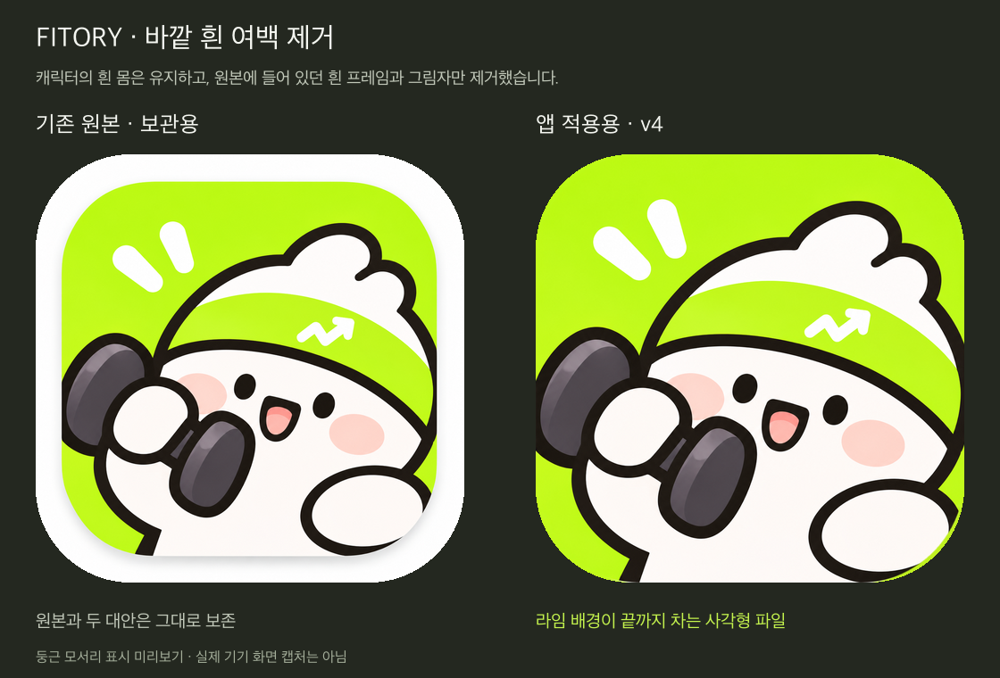

# FITORY 고정 아이콘 자산 · 앱 적용용 v4

2026-11-01 · 첫 번째 이미지 우선 사용 · 전달 원본 v3와 앱 적용용 v4 분리

**현재 앱 아이콘은 첫 번째 이미지에서 바깥 흰 여백·그림자를 제거한 v4다.** 사용자에게 받은 원본에는 둥근 라임 타일 밖의 흰 영역이 포함돼 있었다. v3에는 받은 파일을 그대로 보존하고, v4에는 앱에 적용할 사각형 이미지를 따로 준비했다. 캐릭터를 재생성하거나 다시 그리지 않았다.



[전달받은 세 이미지 목록 미리보기](asset-preview-v3.png)

## 정리한 파일

| 역할 | 새 파일 | 받은 파일명 |
|---|---|---|
| **기본 · 첫 번째 · 라임 덤벨** | [fitory-icon-primary-lime-dumbbell.png](v3/source/fitory-icon-primary-lime-dumbbell.png) | `TalkMedia_i_6b4a52ad747b.png.png` |
| 대안 · 두 번째 · 크림 배경 러닝 | [fitory-icon-alt-running-cream.png](v3/alternates/fitory-icon-alt-running-cream.png) | `KakaoTalk_Photo_2026-11-01-20-40-05.png` |
| 대안 · 세 번째 · 라임 덤벨 클로즈업 | [fitory-icon-alt-dumbbell-closeup-lime.png](v3/alternates/fitory-icon-alt-dumbbell-closeup-lime.png) | `KakaoTalk_Photo_2026-11-01-20-39-58.png` |

세 이미지는 프로젝트 루트에서 위 폴더로 이동했다. 원래 파일명·전달 순서·새 경로·해시는 [자산 목록](v3/source/asset-catalog.json)에 기록했다. 대안은 보관용이며 기본 아이콘 대신 임의로 연결하지 않는다.

## 앱에서 사용하는 파일

| 용도 | 고정 파일 | 앱 공개 경로 |
|---|---|---|
| 앱 적용용 PNG 마스터 · 1094×1094 | [v4/master/icon.png](v4/master/icon.png) | 바깥 흰 여백과 그림자를 제거했다. |
| 앱 적용용 · 1024px PNG | [fitory-app-icon-fullbleed-1024.png](v4/exports/fitory-app-icon-fullbleed-1024.png) | 앱 아이콘 작업에 이 파일을 재사용한다. |
| 기본 아이콘 · SVG 컨테이너 | [v4/exports/app-icon.svg](v4/exports/app-icon.svg) | `/app-icon.svg` |
| 크기별 PNG·ICO 전체 | [v4/exports](v4/exports) | 설치 아이콘·파비콘 경로에 연결했다. |
| 이름 포함 기존 브랜드 로고 · PNG | [v4/exports/fitory-brand-logo.png](v4/exports/fitory-brand-logo.png) | 기존 로고를 별도 보존했다. |
| 이름 포함 기존 브랜드 로고 · SVG | [v4/exports/fitory-brand-logo.svg](v4/exports/fitory-brand-logo.svg) | `/logo.svg` |
| 원본·출력의 검사 기준 | [v4/asset-lock.json](v4/asset-lock.json) | 이전 v1·v2·v3 검사 기준도 유지한다. |

현재 앱 아이콘은 **v4의 흰 여백 없는 첫 번째 이미지**다. v3의 흰 테두리 포함 파일은 원본 보관용이다. 이전의 흰 바탕 v2, F·O 조합과 새 포즈 네 시안은 이력이며 현재 기본 아이콘이 아니다. 기존 이름 포함 브랜드 로고는 v1에서 이어받은 별도 파일이다.

## 이미지 보존 방식

세 원본은 모두 1254×1254 RGBA PNG이고 알파값은 전부 255다. 파일 형식에 알파 채널은 있지만 실제 투명 배경은 없다. 둥근 라임·크림 타일, 바깥 흰 영역, 그림자도 원본에 포함된 픽셀이므로 그대로 보존했다. 별도 레이어나 투명 캐릭터 파일로 설명하지 않는다.

v3의 원본·PNG 마스터는 첫 번째 전달 파일과 바이트가 같다. v4 마스터는 원본의 `(78, 82)`부터 `(1172, 1176)`까지 1094px 정사각형을 가져오고, 둥근 타일 바깥의 모서리를 주변 라임색으로 확장했다. [준비 규칙](v4/source/preparation-recipe.json)을 수치로 고정했고 매번 같은 픽셀이 나오는지 검사한다. SVG는 이 앱 적용용 PNG를 파일 안에 넣은 컨테이너다. 새로 그린 벡터나 편집 가능한 원화가 아니다. 원본의 sRGB·감마·DPI 메타데이터도 받은 파일에 그대로 남겼다.

일반 출력은 같은 v4 마스터를 비율 그대로 축소했다. 얼굴·화살표·덤벨의 주요 영역은 원본 픽셀과 같다. 캐릭터의 흰 몸과 표정은 유지하며, 없앤 것은 바깥 흰 프레임과 그림자다. 라이트·다크에서 같은 기본 아이콘을 사용하며 CSS 필터·색 반전·비균일 확대·자동 배경 제거를 적용하지 않는다.

## 내보내기와 변경 검사

앱 폴더 `diet-coaching-app/app`에서 실행한다.

```sh
npm run brand:verify
npm run brand:export
npm run brand:install
npm run brand:test
```

| 명령 | 하는 일 |
|---|---|
| `brand:verify` | v1·v2·v3·v4 고정 파일 89개와 앱 공개 파일 8개가 등록된 내용과 같은지 검사한다. |
| `brand:export` | v4 준비 규칙과 마스터를 재현한 뒤 크기별 파일을 계산한다. 결과 전체가 등록된 해시와 같을 때만 출력한다. |
| `brand:install` | 검증된 v4 앱 적용용 아이콘과 기존 브랜드 로고를 앱 공개 경로에 복사한다. |
| `brand:test` | 원본·대안 보존, 첫 이미지 우선 지정, 반복 출력, 변조 차단 등을 검사한다. |

내보내기는 Python 3.9 이상과 Pillow 11.3.0을 사용한다. [필요 버전](requirements-export.txt)을 고정했다. 개발·빌드 전 검사는 Node 기본 기능만 사용하므로 Python이나 Pillow가 없어도 실행된다.

원본·마스터·출력·대안·잠금 파일을 SHA-256으로 검사한다. 검사 기준은 별도 코드에도 고정했다. 파일과 잠금 값을 함께 바꾸거나 내보내기 코드를 바꿔도, 등록된 결과와 다르면 실패한다. 다른 결과를 통과시키려고 해시를 다시 등록하는 명령은 제공하지 않는다.

## 앱에 연결한 경로

- `/app-icon.svg` — 흰 여백 없는 v4 PNG가 포함된 SVG다. HTML의 브라우저 아이콘으로 사용한다.
- `/favicon.ico` — v4 앱 적용용의 16·32·48px 출력을 포함한다.
- `/pwa-64x64.png`, `/pwa-192x192.png`, `/pwa-512x512.png` — v4 앱 적용용 설치 아이콘이다.
- `/maskable-icon-512x512.png` — 런처 마스크용으로 같은 구도를 사용한다.
- `/apple-touch-icon-180x180.png` — v4 앱 적용용 iOS 홈 화면 아이콘이다.
- `/logo.svg` — 이름이 포함된 기존 브랜드 로고다.

일반 PNG는 16·32·48·64·128·180·192·256·384·512·1024px와 앱 적용용 원래 크기 1094px다. 받은 원본 1254px는 v3에 보관한다. 마스크용 파일은 192·512px다. v4는 추가 흰 여백 없이 라임 배경이 가장자리까지 차는 사각형 이미지다. 런처 마스크에서 바깥 장식과 손 일부가 가려질 수 있고, 눈·입·머리띠 화살표·덤벨의 식별 부분은 중앙 안전 원 안에 들어가는지 검사했다. 원형 마스크의 주요 영역도 확인했다.

개발 시작·일반 빌드·베타 빌드 전에 자산 검사를 실행한다. 검사 실패를 없애려고 실행 명령에서 검사를 빼지 않는다.

## 버전과 이후 변경

v4는 현재 앱 적용용 버전이며, v3는 받은 기본 원본과 두 대안을 보관하는 버전이다. v1은 트레이너의 이름 포함 원본, v2는 그 원본에서 분리했던 글자 없는 아이콘으로 보존했다. 이전 비교 보드도 이력으로 남긴다.

현재 원본과 대안·마스터·잠금 파일에는 실수로 저장하는 일을 줄이기 위해 읽기 전용 속성을 설정했다. 클로드가 UI를 만들 때마다 생성형 모델로 비슷한 캐릭터를 만들거나 다른 포즈로 대체하지 않는다. 사용자가 기본 아이콘 변경을 요청하면 이전 버전을 보존하고 다음 버전을 등록한다.

세 원본의 바이트 보존, 대안 변조 차단, 반복 출력, 공개 아이콘 일치, 흰 테두리 제거와 주요 픽셀 보존을 확인하는 검사 16개를 통과했다. 프로젝트와 앱의 `AGENTS.md`·`CLAUDE.md`, 클로드 전달문도 현재 기본 이미지와 경로에 맞췄다.
