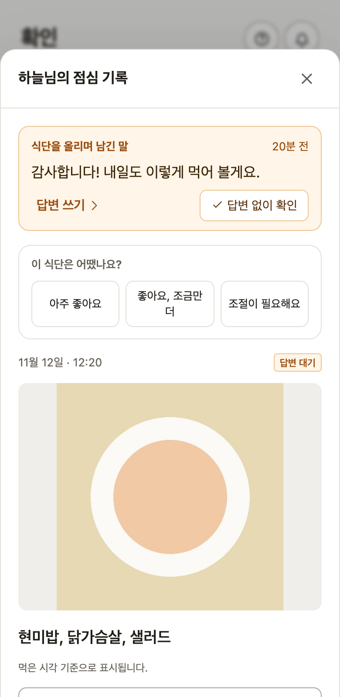
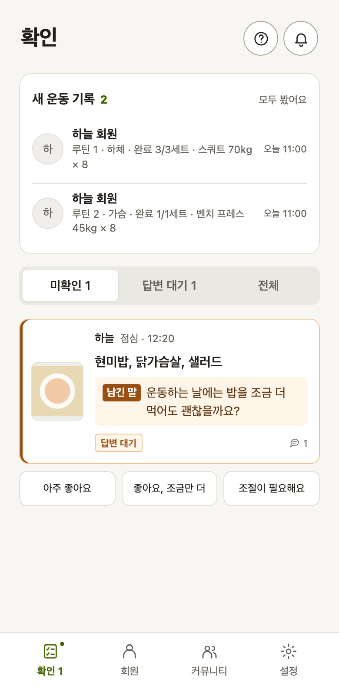
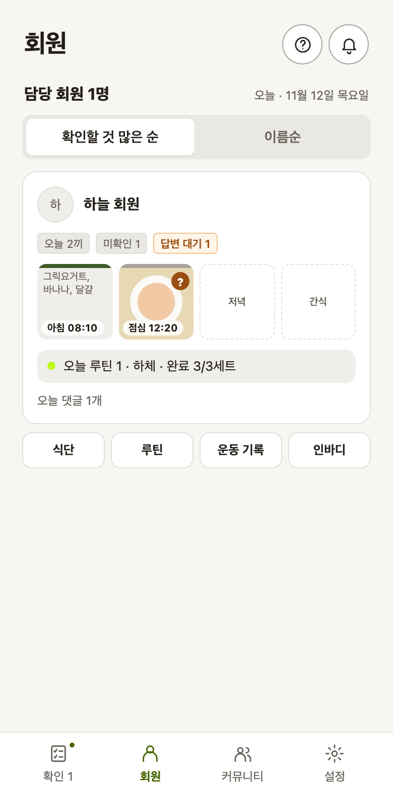

# 식사 확인과 답변을 나눈 이유

[FITORY](../README.md) / 설계 기록 2

회원이 식사를 남기면 트레이너가 보고 피드백하는 것이 서비스의 기본입니다. 이 과정이 이어지려면 트레이너가 확인할 기록을 찾기 쉬워야 하고, 회원의 메시지에 답변이 필요한지도 판단할 수 있어야 합니다. 저는 회원과 트레이너 화면을 직접 써 보며 두 일을 나눴습니다.

## 질문은 놓치기 쉬운데, 모든 메시지에 답해야 했습니다

실제 사용자를 받기 전에 두 역할을 번갈아 시험했습니다. 식사와 함께 등록한 메시지는 사진 아래 작은 회색 글씨로만 보였습니다. 음식에 관한 질문을 적어도 트레이너가 놓치기 쉬웠습니다.

반대로 마지막 메시지를 회원이 보냈으면 답글을 써야 답변 대기에서 빠졌습니다. “감사합니다”처럼 답변이 필요 없는 경우도 마찬가지였습니다. 메시지가 잘 보이게 하면서, 확인만 하고 넘어갈 수 있는 방법도 필요했습니다.

## 메시지를 먼저 보여주고, 답변할지는 트레이너가 고릅니다

식사와 함께 등록한 메시지는 대화의 첫 메시지로 바꾸게 했습니다. 트레이너가 아직 답변하거나 확인하지 않은 메시지는 카드에 미리 보이고, 해당 식사가 목록 위에 올라옵니다. 상세 화면에서도 메시지를 맨 위에 둡니다.

‘답변 없이 확인’ 버튼도 추가했습니다. 답글이 필요 없다고 판단하면 트레이너가 이 버튼으로 정리합니다. 이후 회원이 댓글을 추가하면 다시 답변 대기에 표시됩니다. 답변할지는 트레이너가 판단하고, 앱은 확인 이후 댓글이 추가됐는지 비교합니다.

아래 예시에서는 회원이 “감사합니다! 내일도 이렇게 먹어 볼게요.”라고 했습니다. 트레이너는 이어서 답할 수도 있고, 읽고 확인만 할 수도 있습니다.

버튼을 누르면 확인을 마쳤다는 안내와 함께, 이후 댓글이 추가되면 다시 목록에 표시된다는 설명이 뜹니다([화면 코드](../src/trainer/TrainerApp.tsx)).

결정과 구현 경과는 [변경 기록](../CHANGELOG.md)의 회원 질문 강조·첫 메시지 변경·‘답변 없이 확인’ 항목에 남아 있습니다.

## 현재 화면에서 할 일을 찾는 방식

이 화면은 현재 앱에 예시 기록을 넣어 촬영했습니다. 확인할 식사와 답변을 기다리는 메시지를 구분해 보여줍니다. 답변 대기 숫자를 누르면 해당 식사만 볼 수 있고, 목록에서는 회원의 메시지가 카드에 먼저 보입니다.

트레이너는 미확인·답변 대기·전체로 목록을 거를 수 있습니다. 답변을 기다리는 메시지가 있는 식사는 위에 옵니다([정렬](../src/trainer/TrainerApp.tsx)). 답글이 필요 없는 식사는 카드에서 바로 평가할 수도 있습니다.

새 운동 기록도 확인 탭에서 모아 봅니다.

| 식단과 새 운동을 모은 확인 탭 | 끼니·운동·바로가기를 모은 회원 카드 |
|---|---|
|  |  |

 회원 목록에서는 오늘 한 운동이나 최근 운동한 날을 확인하고, 해당 회원의 식단·루틴·운동 기록·인바디로 바로 이동합니다. 이름과 초성으로 회원을 찾고, 회원 화면에서 돌아오면 보던 회원의 위치를 유지합니다.

새 운동 기록의 확인은 실제로 본 기록과 그 내용을 기준으로 남깁니다. 기록이 뒤늦게 들어와도 놓치지 않고, 회원이 내용을 고치면 다시 확인할 수 있게 합니다. 같은 기록이 시트와 맞춰졌다는 이유만으로 새 업무처럼 반복 표시하지는 않습니다.

## 식단 평가의 문구와 점수

평가 버튼은 트레이너가 누르지만, 그 문구는 회원에게 피드백으로 전달됩니다. 저는 “너무 좋다”, “좋은데 좀 더”, “신경 써 달라”는 세 가지 느낌을 정하고, AI에 버튼 문구로 다듬게 했습니다. 현재의 ‘아주 좋아요’, ‘좋아요, 조금만 더’, ‘조절이 필요해요’가 그 결과입니다.

개별 식사에는 평가 문구를 표시합니다. 두 인바디 측정 사이의 식단을 돌아볼 때는 각 평가를 5·3·1점으로 환산해 평균을 보여줍니다. 5점 만점의 점수 체계도 제가 정했습니다([평가 문구와 점수](../src/lib/rating.ts)).

## 하나의 처리 규칙을 목록과 알림에 적용합니다

식사와 함께 등록한 메시지와 이후 댓글은 하나의 대화로 묶어 시각 순으로 봅니다([`thread`](../src/lib/status.ts)). 화면은 다음 표에서 먼저 해당하는 상태를 표시합니다([`statusOf`](../src/lib/status.ts)).

| 순서 | 상태 | 조건 |
|---|---|---|
| 1 | 답변 대기 | 마지막 메시지를 회원이 보냈고, 트레이너가 그 뒤에 확인하지 않았음 |
| 2 | 확인 대기 | 트레이너가 아직 확인하지 않았음 |
| 3 | 피드백 완료 | 확인했고, 트레이너의 답글이나 평가가 있음 |
| 4 | 확인 완료 | 확인만 했음 |

트레이너가 처리할 식사는 1이나 2에 해당합니다([`needsTrainer`](../src/lib/status.ts)). 식사를 평가하면 확인도 함께 기록합니다([`rate_meal`](../supabase/migrations/20261023000002_meal_rating.sql)). ‘답변 없이 확인’은 확인한 시각 이후의 메시지만 다시 대기로 세는 규칙입니다([`pendingQuestion`](../src/lib/status.ts)).

푸시 알림을 붙이면서도 같은 판정이 필요했습니다. 화면에서 정리한 식사를 알림이 다시 미처리로 세면 트레이너에게 같은 일을 반복해서 알리게 됩니다. Codex의 계획 검토를 반영해, 알림 서버도 수정한 메시지와 확인 시각을 앱과 같은 의미로 비교하게 했습니다([SQL 판정](../supabase/migrations/20261026000002_push.sql)).

## 리뷰에서 확인한 예외와 보강

| 시점 | Codex가 찾은 문제 | 반영한 내용 |
|---|---|---|
| v1.3 | 확인한 뒤 회원이 처음 등록한 메시지를 질문으로 고쳐도, 최초 등록 시각으로 판정해 다시 대기에 오르지 않음 | 마지막으로 고친 시각으로 판정 |
| v1.3 | 오래된 식사에 새 질문을 남기면 트레이너의 조회 범위 밖이라 보이지 않음 | 최근 회원의 메시지가 있는 식사를 조회 범위에 포함 |
| v1.7 계획 | 알림 서버가 회원·트레이너의 마지막 발언만 비교하면 앱의 ‘확인’ 규칙을 재현하지 못함 | 앱과 같은 규칙을 알림에 적용 |

알림 계획의 검토 원문은 [2차 피드백](reference/푸시알림_계획_2차피드백_261026.md)에 있습니다.

## 동작 확인

- 화면 흐름 검증은 등록 때 남긴 메시지가 대기에 표시되는지([`e2e-flow.mjs`](../scripts/e2e-flow.mjs#L225-L226)), ‘답변 없이 확인’ 뒤 강조와 대기가 풀리는지 확인합니다([같은 파일](../scripts/e2e-flow.mjs#L273-L293)).
- 확인한 뒤 수정한 메시지가 다시 답변 대기에 표시되는지는 권한 검증에서도 확인합니다([`backend-check.mjs`](../scripts/backend-check.mjs#L301-L302)).

답변이 필요한지는 트레이너가 판단합니다. 앱은 확인할 메시지를 모아 보여주고 처리 여부를 기록합니다.

관련 설계: [알림](04_알림_설계.md) · [운동 기록과 변화 보고서](07_앞으로의_계획.md)
