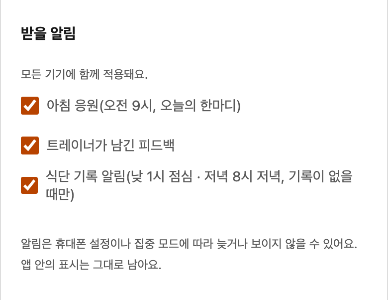

# 트레이너와 회원에게 다르게 알리는 방식

[식단노트](../README.md) / 설계 기록 4

앱 안에서는 확인할 식사와 새 피드백을 볼 수 있지만, 앱을 닫으면 새 소식이 생겼는지 알 수 없었습니다. 첫 버전의 기록·피드백 기능에 이어, 10월 27일 v1.7에서 휴대폰 알림을 추가했습니다.

트레이너는 여러 회원의 기록을 확인하고 회원은 자신의 피드백을 받습니다. 저는 이 차이에 맞춰 알리는 방식을 따로 정했습니다. 알림 계획과 검토 원문은 [계획서](reference/푸시알림_계획_261026.md), [1차 검토](reference/푸시알림_계획_피드백_261026.md), [2차 검토](reference/푸시알림_계획_2차피드백_261026.md)에 있습니다.

## 트레이너에게는 모아서, 회원에게는 바로

트레이너에게는 회원이 식사를 남길 때마다 보내지 않고, 하루 3회 또는 5회 처리할 일의 건수를 모아 보내기로 했습니다. 정해진 시각이어도 지난 요약 이후 새로 들어온 처리할 일이 없으면 보내지 않습니다.

회원에게는 자신의 식사에 피드백이 달렸음을 바로 알립니다. 처음 계획은 3분간 모아 보내는 것이었지만, 저는 10월 27일 구현 중에 바로 보내는 방식으로 바꿨습니다. 알림 전송 전에 회원이 이미 읽었다면 보낼 필요가 없어집니다. 이때는 전송을 취소합니다.

기록 알림은 점심과 저녁을 따로 확인하게 했습니다. 점심을 기록했어도 저녁은 남기지 않았을 수 있기 때문입니다. 아래 화면에서 회원은 응원·피드백·기록 알림 중 받을 것을 고릅니다. 종류별 선택은 계정 전체에 적용해, 한 기기에서 끄면 다른 기기에서도 꺼집니다.

화면은 예시 계정으로 재현했습니다. 필요한 알림을 회원이 고르는 현재 모습을 보여줍니다.

## 보내는 알림

| 알림 | 받는 사람 | 보내는 때 | 누르면 |
|---|---|---|---|
| 확인할 소식 요약 | 트레이너 | 하루 3회(9·15·21시), 설정하면 5회(9·12·15·18·21시). 지난 요약 뒤에 새로 들어온 처리할 일이 있을 때만 | 확인 목록 |
| 새 피드백 | 회원 | 트레이너가 평가나 답글을 저장한 직후. 보내기 전에 회원이 읽었으면 보내지 않음 | 피드백 탭 |
| 점심·저녁 기록 | 회원 | 낮 1시·저녁 8시, 그날 그 끼니 기록이 없을 때만 | 식단 기록 |
| 아침 응원 | 회원 | 오전 9시. 담당 트레이너가 그날 쓴 한마디, 없으면 그날의 기본 문구 | 오늘 화면 |

## 제가 정한 정책과 계획 검토에서 정한 조건

| 결정 | 내용 | 기록 |
|---|---|---|
| 트레이너에게는 모아서 | 회원마다 따로 보내지 않고 몇 시간마다 한 번 건수만 보냅니다 | 제 결정(계획서 요구 대조표의 결정 1) |
| 밤 시간 제한 없음 | 받기 싫은 시간은 각자 휴대폰의 방해 금지 모드로 조절합니다 | 제 결정(결정 2) |
| 종류별 설정은 계정 전체에 | 한 기기에서 끄면 다른 기기도 꺼지고, 화면에 '모든 기기에 함께 적용돼요'라고 씁니다 | 제 결정(결정 3) |
| 기록 알림은 점심·저녁 두 번 | 점심을 남겨도 저녁을 잊을 수 있어 두 번 확인합니다 | 제 결정(결정 4) |
| 피드백은 묶지 않고 바로 | 처음 계획의 3분 묶음을 구현 중에 즉시 알림으로 바꿨습니다 | 제 결정(10월 27일) |
| 아침 응원·알림 목록 추가 | 머리글 종 버튼으로 최근 1주일 소식을 모아 보고, 회원에게 아침 응원을 보냅니다 | 제 요청(10월 27일) |
| 잠금 화면에는 건수와 종류만 | 이름·식단 내용·남긴 글·평가 결과·인바디 수치는 앱을 열어야 보입니다 | 계획서 |
| 알림을 눌렀다고 읽음으로 치지 않음 | 앱 화면에서 실제로 확인했을 때만 읽음·확인으로 처리합니다 | 계획서 |
| 허용 요청은 버튼을 누를 때 | 아이폰은 사람이 누른 동작에서만 허용 창을 띄울 수 있어, 앱을 처음 열 때 묻지 않습니다 | 계획서 |

아이폰은 iOS 16.4 이상에서 홈 화면에 추가한 앱으로 열었을 때만 알림을 켤 수 있습니다. 그래서 알림 설정 창에 아이폰·안드로이드별 8단계 그림 안내를 붙였습니다(그림과 문구는 Codex가 작성).

## 처리한 일을 다시 알리지 않게 확인합니다

- 식사·댓글을 저장하는 경로에 알림 장치를 달지 않았습니다. 서버의 예약 작업이 10분마다 지금 상태를 훑어 보낼 알림을 만듭니다([`20261026000002_push.sql`](../supabase/migrations/20261026000002_push.sql#L575-L577)).
- 알림을 만든 뒤에도 보내기 전까지 상태가 바뀔 수 있으므로, 처음 보낼 때와 모든 재시도 직전에 근거를 다시 확인합니다. 회원이 이미 읽었거나 트레이너가 이미 처리했으면 보내지 않습니다([`push_payload`](../supabase/migrations/20261026000002_push.sql#L420-L478)).
- 서버의 판정은 앱의 상태 규칙과 같은 의미로 짰습니다. 트레이너의 '답변 없이 확인'과 회원이 고쳐 쓴 말까지 앱과 똑같이 셉니다([SQL 판정](../supabase/migrations/20261026000002_push.sql#L7-L28), [트레이너 업무 흐름과 처리 규칙](02_트레이너_업무_흐름과_처리_규칙.md)).
- 피드백 알림은 식사마다 어느 피드백까지 알렸는지 기록합니다. 저장과 알림 만들기가 겹쳐도 피드백을 놓치지 않게 하기 위해서입니다.
- 전체 송신 스위치(`off`·`testers`·`all`)로 모두 멈추거나 시험 계정에만 보낼 수 있습니다.

## 계획 검토에서 바꾼 것

계획서는 10월 26～27일에 걸쳐 5차까지 고쳤습니다. 그 가운데 Codex 검토로 바꾼 것은 다음과 같습니다.

| 검토 | 지적 | 반영 |
|---|---|---|
| 1차 | 실제 휴대폰 시험을 운영 배포 뒤로 미루면, 알림을 켜지 않은 사용자도 바뀐 서비스워커(앱을 설치형으로 돌리는 배경 코드)를 시험 전에 받게 됨 | 실제 휴대폰 확인을 운영 배포 전으로 옮김 |
| 1차 | 일반 PIN 변경과 계정 되찾기에서 다른 기기의 알림을 같이 다룸 | 두 경우를 나눠 정함(PIN 변경은 다른 기기 알림 유지, 되찾기는 중단) |
| 1차 | 회원이 고쳐 쓴 말을 질문으로 세지 않음 | 질문에 포함 |
| 1차 | 알림을 누르면 작성 중인 입력이 사라질 수 있음 | 작성 창을 그대로 두고 뒤 화면만 바꿈 |
| 2차 | '회원 말이 트레이너 말보다 늦은가'만으로는 앱의 질문 판정을 재현할 수 없음 | 서버 판정을 앱의 `status.ts`와 같은 규칙으로 |
| 2차 | 재시도할 때 근거가 사라졌는지 다시 보지 않음 | 모든 재시도 직전에 다시 확인 |
| 2차 | 같은 휴대폰에서 계정을 바꾸면 이전 계정의 알림이 갈 수 있음 | 계정 전환 때 이전 계정의 대기 작업을 끊음 |

## 실제 휴대폰 시험과 개통

휴대폰 알림은 https 주소로 연 앱에서만 켤 수 있습니다. 새 Supabase 프로젝트를 만들지 않고(제 결정), 로컬 시험 환경에 Cloudflare 임시 터널로 https 주소만 잠시 붙였습니다. 시험 명령은 DB 주소가 운영을 가리키면 빌드와 터널을 띄우지 않고 멈춥니다([`phonetest-guard-check.mjs`](../scripts/phonetest-guard-check.mjs)).

10월 27일 실제 아이폰에서 시험 알림·새 피드백·점심 기록·트레이너 요약을 받고, 누르면 해당 화면으로 가는 것을 확인했습니다. 운영에는 송신 스위치를 시험 계정(제 계정과 트레이너 계정)에만 연 상태로 배포했고, 두 휴대폰에서 받는 것을 확인한 뒤 전체로 열었습니다([변경 기록](../CHANGELOG.md) 10월 27일).

## 확인한 것

- 알림 검증은 알림 생성 규칙, 트레이너 한마디 우선, 끄기, 하루 한 번, 보내기 직전 재확인과 재시도를 로컬 서버 기능과 시험 수신 서버로 확인합니다([`push-check.mjs`](../scripts/push-check.mjs)).
- 운영 배포 뒤 Codex 리뷰(v1.7.1·v1.7.2)에서 나온 알림 설정·알림 목록의 경계 상황도 화면 조각 검증에 넣었습니다([출시 후 운영](05_출시_후_운영.md)).

## 한계

- 알림 서버가 받았다고 휴대폰에 도착했다는 뜻은 아닙니다. 집중 모드·네트워크·휴대폰 설정에 따라 늦거나 보이지 않을 수 있어, 안내 문구에 '놓치지 않는다'는 표현을 쓰지 않았습니다. 앱 안 표시는 알림과 관계없이 남습니다.
- 10월 28일 16시 기준으로 알림을 켠 계정은 4개입니다(운영 DB 집계, 테스트 계정 제외). 알림으로 기록량이나 재방문이 늘었는지는 아직 측정하지 않았습니다.

관련 설계: [확인과 답변을 나눈 규칙](02_트레이너_업무_흐름과_처리_규칙.md) · [출시 후 운영](05_출시_후_운영.md)
