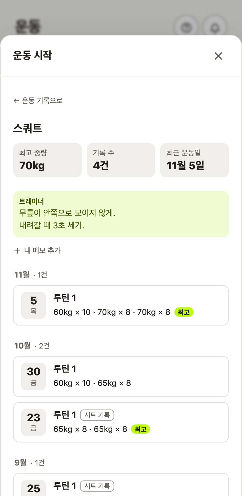

# AI와 함께 개발한 방식

[FITORY](../README.md) / 설계 기록 6

제가 다니는 PT센터에서 쓸 앱이었기 때문에 회원인 제 입장과 트레이너가 처리할 일을 함께 살폈습니다. 직접 쓰다가 불편을 찾기도 했고, Codex가 제시한 아이디어를 보고 사용 방식을 다시 기획하기도 했습니다. 정한 내용을 Claude Code에 구현하게 한 뒤, Codex에 검토를 맡겼습니다.

## 역할 분담

| 맡은 쪽 | 한 일 | 기록에 남은 예 |
|---|---|---|
| 저 | 범위와 우선순위, 제품 기획과 화면 문구, 검토 의견의 반영 여부, 배포 시점, 실사용 점검 | 계정 복구 재기획, [식단 확인·평가 방식](02_트레이너_업무_흐름과_처리_규칙.md), [알림 방식](04_알림_설계.md), 리뷰 기준 요청 |
| Claude Code | 구현, 검증 스크립트 작성과 실행, 배포 스크립트, 변경 기록 | 저장소의 코드와 [변경 기록](../CHANGELOG.md) |
| Codex | 계획 검토, 코드 리뷰와 결함 재현, 일부 콘텐츠 | 리뷰 문서([예시 1](reference/코드리뷰_v1_7_코드품질평가_20261027.md), [예시 2](reference/코드리뷰_v1_7_재리뷰_20261027.md)), 알림 설정 그림 안내, 기본 응원 문구 후보 |

## 새 기능이 기존 앱과 같은 규칙을 쓰는지도 검토합니다

이후 개발에도 적용할 리뷰 기준을 요청했습니다. 기능이 동작하는지에 더해 기존 앱에 일관되게 들어갔는지, 다음 변경을 감당할 수 있는지까지 보기 위해서입니다. 요청을 바탕으로 정리한 [코드 리뷰 평가 기준](reference/코드리뷰_평가기준.md)을 사용합니다.

예를 들어 ‘답변 없이 확인’으로 정리한 메시지를 알림 서버가 다시 미처리로 세면, 기능별 시험은 통과해도 트레이너는 이미 끝낸 일을 다시 알림으로 받습니다. 이 규칙은 화면과 서버에서 같은 의미로 적용해야 했습니다([알림 계획 검토](reference/푸시알림_계획_2차피드백_261026.md)).

평가 기준은 기존 구조와의 연계, 같은 규칙의 적용, 늦게 도착하는 응답, 오류 복구, 보안과 데이터 무결성 등을 다룹니다. 동작 결함과 구조 문제는 따로 보고하고, 테스트 개수나 임의의 총점으로 품질을 대신하지 않게 했습니다.

## 회원 의견을 실제 사용 상황으로 구체화합니다

### 사진 버튼 요청에서 필수 입력 순서까지

회원은 식단 등록 때 스크롤을 줄이고 사진 찍기·앨범 선택을 나눠 달라고 했습니다. AI가 버튼·간격·미리보기 크기를 조정한 시안을 만들었지만, 저는 선택 사진이 맨 위에 있고 필수 음식명은 가운데에 있는 점을 짚었습니다. 기존 순서에 필수 표시만 붙이는 안과 순서를 바꾸는 안을 비교해 **미리 채운 날짜·시각·끼니 다음에 음식명을, 사진과 한마디는 그 뒤에** 두기로 정했습니다.

기종별로 미리보기를 줄이는 제안은 채택하지 않았습니다. 사진은 같은 높이로 확인하게 하고, 좁은 화면에서 일부 스크롤이 생기는 것은 받아들였습니다. ‘한 화면’ 요구를 위해 선택한 사진의 확인 경험까지 바꾸지는 않은 판단입니다.

[식단 입력 구현](../src/components/MealForm.tsx)에서 필수 음식명과 선택 사진의 순서를 볼 수 있습니다. 위 설명은 11월 9일 시안 선택에 근거합니다. 입력 시간 단축을 측정했다는 뜻은 아닙니다.

### 운동 검색을 운동 중 참고와 전체 조회로 나눴습니다

회원의 요청은 ‘운동을 검색하면 예전에 한 기록과 날짜를 보고 싶다’였습니다. AI는 다른 운동 앱을 조사해 진입 위치와 표시 방법을 제안했습니다. 저는 기록 목록 제목 옆의 ‘운동 찾기’를 택하고, 운동 중에는 **지난 날짜와 가장 무거운 세트 하나**를 먼저 보여주는 안을 선택했습니다.

| 검토한 안 | 선택과 이유 |
|---|---|
| 운동 중에는 표시하지 않고 검색으로만 보기 | 입력하다가 매번 별도 검색해야 하므로 채택하지 않음 |
| 지난 모든 세트를 한 줄에 표시 | 운동마다 설명이 길어져 입력 화면을 밀어내므로 채택하지 않음 |
| 지난 날짜·가장 무거운 세트, 누르면 전체 이력 | 필요한 중량을 먼저 확인하고 자세한 기록은 펼쳐 보게 선택 |

세트 표에 ‘지난 값’ 열을 더하는 안은 입력 칸을 좁힌다는 이유로 AI가 시안에서 제외했습니다. 이를 제가 직접 조사·발명한 것으로 쓰지 않습니다. 과거 기록을 열었다 닫아도 작성 중인 세트는 유지합니다. 검색은 앱과 시트 기록을 함께 읽고, 띄어쓰기 차이는 같은 운동으로 봅니다.

| 운동 중 참고 | 전체 이력 |
|---|---|
|  |  |

[운동 입력](../src/components/Workout.tsx) · [운동 검색·이력](../src/components/ExerciseFind.tsx)

### 메모를 다음 루틴에서도 쓰려면 어디에 붙여야 합니까

회원은 자세 피드백을 세트 아래에서 보고 다음 주에도 유지하고 싶다고 했습니다. 저는 트레이너도 작성할 수 있게 요구했고, AI가 제안한 운동별 메모와 작성자별 칸 분리를 채택했습니다. 세트마다 붙이면 루틴의 세트 수가 바뀔 때 어디로 이어야 할지 불분명하고, 한 칸을 함께 쓰면 서로의 내용을 덮어쓸 수 있기 때문입니다.

메모는 운동 이름에 연결하고 각자 자기 칸만 고칩니다. 같은 이름이면 다음 루틴에도 이어지며 띄어쓰기 차이는 통합합니다. 이름이 달라진 동작에 자동으로 옮기지는 않습니다. 메모 저장은 운동 기록 저장과 별도로 처리하고 시트에는 쓰지 않습니다.

새 트레이너 메모를 바로 알리자는 선택지도 있었지만, 해당 운동을 할 때 읽을 참고 정보라는 이유로 알리지 않는 안을 채택했습니다. 저장 성공과 실패, 작성 중 내용의 보호는 [운영 문서](05_출시_후_운영.md)에 설명합니다. 메모의 위치·작성자·이용 시점을 함께 정한 사례입니다.

## 검토에서 드러난 접근 권한도 제품 흐름에 반영합니다

Codex가 트레이너의 PIN 재설정 권한으로 회원 계정에 접근할 위험을 발견했습니다. 저는 연락처 없는 가입을 유지하면서 회원이 직접 복구 질문과 기존 로그인 기기로 계정을 되찾는 절차를 기획했습니다. 발견은 Codex, 재기획과 채택은 저, 구현은 Claude Code의 역할입니다. 상세 절차와 재검토 예외는 [가입과 계정 보안](03_가입과_계정_보안.md)에 모았습니다.

## 리뷰를 돌린 방식

리뷰 문서는 기준 커밋, 등급(P0～P3)을 붙인 결함, 코드 위치, 재현 방법과 결과, 고칠 방향으로 짜여 있습니다. 재리뷰는 앞선 지적이 해결됐는지와 새로 찾은 것을 나눠 씁니다. 리뷰어는 코드를 읽고 재현만 하며 앱 코드는 고치지 않았습니다.

검토에서는 실제 사용 흐름을 따라 문제가 드러나는 조건을 재현합니다. 운동 이력을 열었다 돌아올 때 작성 중인 세트가 남는지, 메모 저장 중 화면을 옮기면 결과를 놓치지 않는지, 시트에서 사람이 바꾼 값이 앱 저장으로 덮이지 않는지를 확인합니다.

문제가 발견되면 해당 줄만 고치는 데서 끝내지 않고, 같은 상태를 읽는 목록·상세·보고서에도 영향을 확인합니다. 반영 여부는 재현 조건과 검증 결과로 판단합니다.

## 검증

검증은 일반 테스트 프레임워크 대신 Node 스크립트로 짰고, 대부분 로컬 Supabase에 실제로 붙어 돕니다. 구성은 [실행·검증·배포 안내](운영_안내.md#검증)에 있습니다.

- **고치기 전 코드에서 실패하는지 확인** — 결함을 고친 기록 대부분에는, 새 검증이 고치기 전 코드에서 실패하고 고친 뒤 통과하는 것을 확인한 결과가 함께 남아 있습니다. 한 번은 고치기 전 코드가 커밋돼 있지 않아 이 확인을 하지 못했고, 그 사실도 기록에 남겼습니다.
- **리뷰의 재현을 검증으로 옮김** — Codex가 재현한 경쟁 상황(동시에 들어온 계정 되찾기 등)은 DB 행 잠금으로 요청을 실제로 겹치는 검증으로 옮겼습니다([`race-check.mjs`](../scripts/race-check.mjs)).
- **실제 조건에 가깝게** — 화면 흐름 검증은 휴대폰과 같은 조건을 만들려고 맥의 와이파이 주소로 접속합니다. 새 버전 적용 검증은 실제 빌드 두 개를 번갈아 띄웁니다.

## 설계와 검토 자료

개발 범위와 사용 규칙은 제가 정하고, Claude Code가 구현하며 Codex가 계획과 코드를 검토합니다. 검토에서 나온 제안은 제품 목적과 기존 사용 흐름을 기준으로 채택하거나 수정합니다.

공개된 검토 원문은 [코드 품질 검토](reference/코드리뷰_v1_7_코드품질평가_20261027.md)와 [후속 검토](reference/코드리뷰_v1_7_재리뷰_20261027.md)에서 볼 수 있습니다. 현재 운영의 기록 보호 방식은 [출시 후 운영](05_출시_후_운영.md), 운동·식단을 연결한 판단은 [운동 기록과 변화 보고서](07_운동기록과_코칭보고서.md)에 정리했습니다.
