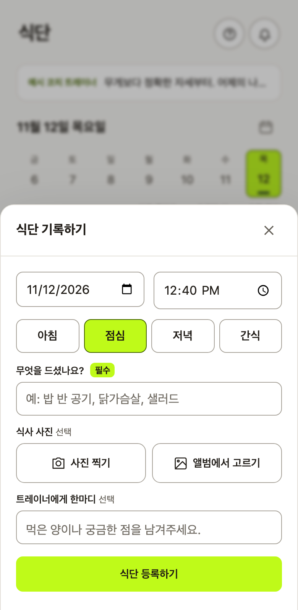
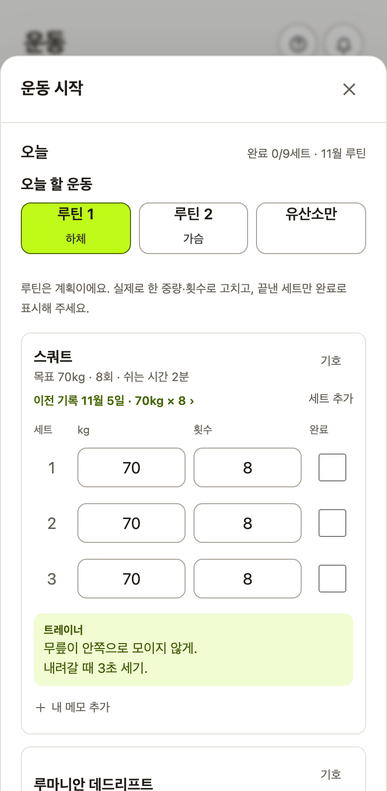

# AI와 함께 개발한 방식

[FITORY](../README.md) / 설계 기록 6

제가 다니는 PT센터에서 쓸 앱이었기 때문에 회원인 제 입장과 트레이너가 처리할 일을 함께 살폈습니다. 직접 쓰다가 불편을 찾기도 했고, Codex가 제시한 아이디어를 보고 사용 방식을 다시 기획하기도 했습니다. 정한 내용을 Claude Code에 구현하게 한 뒤, Codex에 검토를 맡겼습니다.

## 계정 복구를 회원 본인이 할 수 있게 다시 기획했습니다

이메일이나 전화번호 없이 가입하게 했지만, PIN을 잊었을 때는 트레이너가 새 PIN을 정해 주는 구조였습니다. Codex는 이 권한으로 트레이너가 회원 계정에 로그인할 수 있다는 문제를 찾았습니다.

저는 Codex의 지적과 아이디어를 보고 회원이 직접 복구하는 방식을 기획했습니다. 가입할 때 정한 질문에 답해 새 PIN을 설정하고, 다른 사람이 PIN을 바꿨다면 기존에 로그인해 둔 기기에서 계정을 되찾게 했습니다. 간단한 가입 방식은 유지하고, 앱에서 트레이너가 회원의 PIN을 정하는 기능은 없앴습니다.

Claude Code는 이 절차를 구현했습니다. Codex의 재검토에서는 복구 도중 다른 요청이 들어오거나, 끝난 로그인 정보가 남아 있는 경우 등을 확인했습니다. 이 과정에서 보완한 조건과 검증은 [가입과 계정 보안](03_가입과_계정_보안.md)에 정리했습니다.

## 역할 분담

| 맡은 쪽 | 한 일 | 기록에 남은 예 |
|---|---|---|
| 저 | 범위와 우선순위, 제품 기획과 화면 문구, 검토 의견의 반영 여부, 배포 시점, 실사용 점검 | 계정 복구 재기획, [식단 확인·평가 방식](02_트레이너_업무_흐름과_처리_규칙.md), [알림 방식](04_알림_설계.md), 리뷰 기준 요청 |
| Claude Code | 구현, 검증 스크립트 작성과 실행, 배포 스크립트, 변경 기록 | 저장소의 코드와 [변경 기록](../CHANGELOG.md) |
| Codex | 계획 검토, 코드 리뷰와 결함 재현, 일부 콘텐츠 | 리뷰 문서([예시 1](reference/코드리뷰_v1_7_코드품질평가_20261027.md), [예시 2](reference/코드리뷰_v1_7_재리뷰_20261027.md)), 알림 설정 그림 안내, 기본 응원 문구 후보 |

## 새 기능이 기존 앱과 같은 규칙을 쓰는지도 검토합니다

이후 개발에도 적용할 리뷰 기준을 요청했습니다. 기능이 동작하는지에 더해 기존 앱에 일관되게 들어갔는지, 다음 변경을 감당할 수 있는지까지 보기 위해서입니다. 요청을 바탕으로 정리한 [코드 리뷰 평가 기준](reference/코드리뷰_평가기준.md)을 사용합니다.

예를 들어 ‘답변 없이 확인’으로 정리한 메시지를 알림 서버가 다시 미처리로 세면, 기능별 시험은 통과해도 트레이너는 이미 끝낸 일을 다시 알림으로 받습니다. 이 규칙은 화면과 서버에서 같은 의미로 적용해야 했습니다([알림 계획 검토](reference/푸시알림_계획_2차피드백_261026.md)).

평가 기준은 기존 구조와의 연계, 같은 규칙의 적용, 늦게 도착하는 응답, 오류 복구, 보안과 데이터 무결성 등을 다룹니다. 동작 결함과 구조 문제는 따로 보고하고, 테스트 개수나 임의의 총점으로 품질을 대신하지 않게 했습니다.

## 회원 의견을 실제 사용 상황으로 구체화합니다

식단 등록을 한 화면에 담아 달라는 의견에는 버튼 크기와 간격뿐 아니라 입력 순서도 검토했습니다. 저는 선택 항목인 사진이 맨 위에 있고 필수인 음식 이름은 가운데에 있다는 점을 짚었습니다. 필수 칸을 먼저 두는 안과 기존 순서를 유지하는 안을 시안으로 비교한 뒤, 필수 칸을 앞에 두기로 정했습니다. 사진 미리보기는 유지했습니다.

| 입력 순서를 바꾼 식단 등록 | 운동 중 이전 기록과 설명 확인 |
|---|---|
|  |  |

회원 의견은 요청한 버튼이나 화면을 그대로 추가하는 데서 끝내지 않습니다. 예를 들어 운동 기록 검색은 운동 중에 이전 중량을 확인하려는 상황과, 운동 밖에서 과거 기록을 찾아보는 상황으로 나눴습니다. 운동 중에는 해당 동작 아래에 이전 기록을 보여주고, 별도 검색은 기록 화면에서 열도록 했습니다.

동작별 메모도 회원·트레이너가 자기 칸을 수정하고, 다음 루틴에서 같은 운동을 만나면 이어 보도록 정했습니다. 화면 변경은 이전 화면과 시안을 비교하며 확인한 뒤 구현과 코드 검토로 넘깁니다.

## 리뷰를 돌린 방식

리뷰 문서는 기준 커밋, 등급(P0～P3)을 붙인 결함, 코드 위치, 재현 방법과 결과, 고칠 방향으로 짜여 있습니다. 재리뷰는 앞선 지적이 해결됐는지와 새로 찾은 것을 나눠 씁니다. 리뷰어는 코드를 읽고 재현만 하며 앱 코드는 고치지 않았습니다.

검토에서는 실제 사용 흐름을 따라 문제가 드러나는 조건을 재현합니다. 운동 이력을 열었다 돌아올 때 작성 중인 세트가 남는지, 메모 저장 중 화면을 옮기면 결과를 놓치지 않는지, 시트에서 사람이 바꾼 값이 앱 저장으로 덮이지 않는지를 확인합니다.

문제가 발견되면 해당 줄만 고치는 데서 끝내지 않고, 같은 상태를 읽는 목록·상세·보고서에도 영향을 확인합니다. 반영 여부는 재현 조건과 검증 결과로 판단합니다.

## 검증

검증은 일반 테스트 프레임워크 대신 Node 스크립트로 짰고, 대부분 로컬 Supabase에 실제로 붙어 돕니다. 구성은 [실행·검증·배포 안내](운영_안내.md#검증)에 있습니다.

- **고치기 전 코드에서 실패하는지 확인** — 결함을 고친 기록 대부분에는, 새 검증이 고치기 전 코드에서 실패하고 고친 뒤 통과하는 것을 확인한 결과가 함께 남아 있습니다. 한 번은 고치기 전 코드가 커밋돼 있지 않아 이 확인을 하지 못했고, 그 사실도 기록에 남겼습니다.
- **리뷰의 재현을 검증으로 옮김** — Codex가 재현한 경쟁 상황(동시에 들어온 계정 되찾기 등)은 DB 행 잠금으로 요청을 실제로 겹치는 검증으로 옮겼습니다([`race-check.mjs`](../scripts/race-check.mjs)).
- **실제 조건에 가깝게** — 화면 흐름 검증은 휴대폰과 같은 조건을 만들려고 맥의 와이파이 주소로 접속합니다. 새 버전 적용 검증은 실제 빌드 두 개를 번갈아 띄웁니다.

## 설계와 검토 자료

개발 범위와 사용 규칙은 제가 정하고, Claude Code가 구현하며 Codex가 계획과 코드를 검토합니다. 검토에서 나온 제안은 제품 목적과 기존 사용 흐름을 기준으로 채택하거나 수정합니다.

공개된 검토 원문은 [코드 품질 검토](reference/코드리뷰_v1_7_코드품질평가_20261027.md)와 [후속 검토](reference/코드리뷰_v1_7_재리뷰_20261027.md)에서 볼 수 있습니다. 현재 운영의 기록 보호 방식은 [출시 후 운영](05_출시_후_운영.md), 운동·식단을 연결한 판단은 [운동 기록과 변화 보고서](07_앞으로의_계획.md)에 정리했습니다.
