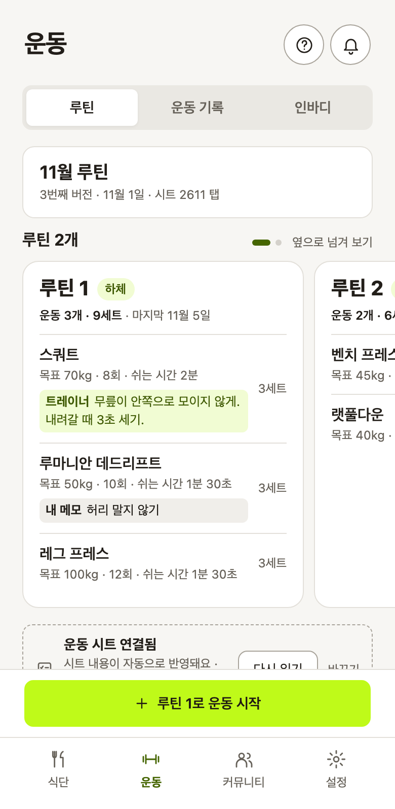
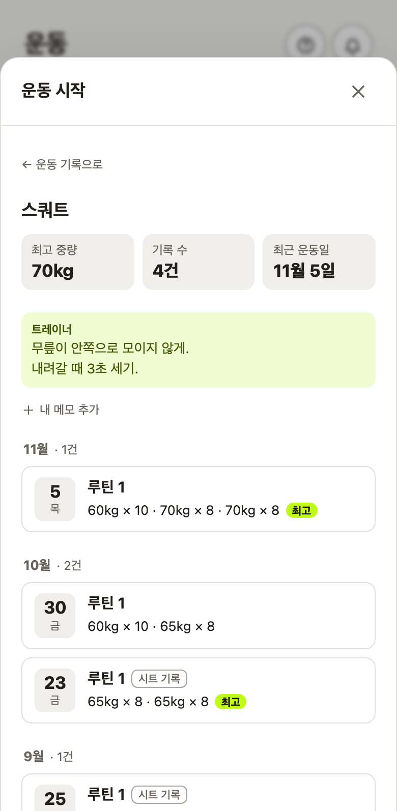
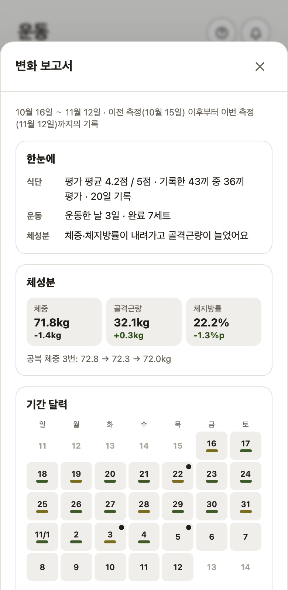
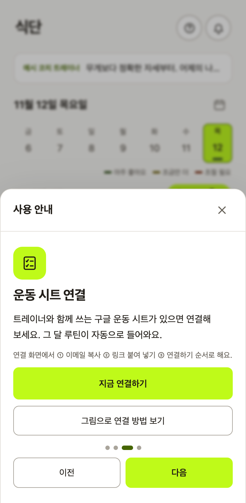
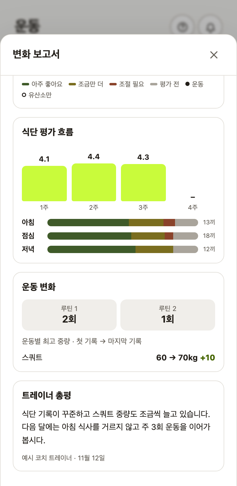

# 운동과 식단을 함께 보고 다음 목표를 정하기

[FITORY](../README.md) / 운동·식단·인바디 연결

FITORY는 트레이너가 작성한 운동 루틴, 회원의 실제 수행과 식단, 인바디 변화를 함께 보여줍니다. 트레이너의 스프레드시트 작성 방식은 유지하면서, 회원은 앱에서 기록하고 두 사람이 같은 자료로 다음 계획을 논의하도록 구성했습니다.

## 현재 갖춰진 기능

| 루틴 | 운동 이력 | 변화 보고서 |
|---|---|---|
|  |  |  |

회원은 식단·운동·인바디·공복 체중을 기록하고, 트레이너는 식단을 평가하거나 답글과 운동 메모·기간 총평을 남깁니다. 운동 계획과 수행 기록은 구분하며, 변화 보고서는 두 인바디 측정 사이의 같은 기간을 사용합니다.

| 자료 | 앱에서 이어지는 사용 |
|---|---|
| 트레이너의 운동 시트 | 루틴 확인, 세트별 실제 수행 기록, 시트 반영 |
| 과거 운동 기록 | 운동 중 이전 중량 확인, 운동별 이력 검색 |
| 운동별 메모 | 회원·트레이너의 설명을 다음 루틴에서도 참고 |
| 식단 평가와 운동 수행 | 측정 기간의 생활 기록을 함께 검토 |
| 인바디 변화와 트레이너 총평 | 확인된 변화와 다음 계획을 논의 |

## 1. 트레이너가 작성한 운동 루틴을 앱에서 함께 봅니다

트레이너가 이미 쓰는 스프레드시트를 앱의 입력 방식으로 전부 바꾸게 하지 않았습니다. 연결한 시트에서 루틴과 기록을 가져오고, 회원이 앱에서 남긴 수행도 시트에 반영합니다.

반영할 값은 실제 완료한 세트를 기준으로 정합니다. 한 운동을 여러 세트 했다면 높은 중량을 대표값으로 쓰되, ‘20+5’처럼 두 동작의 중량을 함께 적은 표기는 하나의 합계로 바꾸지 않습니다. 기존 시트에서 그 표기가 무엇을 뜻하는지 유지하려는 기준입니다.

시트와 앱의 값이 다르다고 무조건 앱의 값으로 덮어쓰지는 않습니다. 앱이 쓴 칸과 값을 기록해 두고, 그 값이 그대로 있을 때 갱신합니다. 트레이너가 직접 입력하거나 수정한 값은 보존합니다. 시트 반영에 실패해도 앱에 저장된 운동 기록은 남습니다.

### 시트 반영의 예외와 기록 보호

앱의 운동 기록 저장과 스프레드시트 반영은 따로 결과를 확인합니다. 시트에 쓰지 못했다고 앱에 저장한 기록까지 없애지 않고, 어느 쪽까지 저장됐는지 알려줍니다.

| 상황 | 처리 기준 |
|---|---|
| 시트의 칸이 비어 있음 | 완료한 세트의 기록을 정해진 방식으로 반영 |
| 앱이 쓴 값이 시트에 그대로 남아 있음 | 해당 앱 기록을 수정하면 연결된 칸도 갱신 |
| 트레이너가 직접 입력하거나 고친 값이 있음 | 앱의 값으로 덮어쓰지 않음 |
| 시트를 읽거나 쓰는 데 실패함 | 앱 기록은 보존하고, 반영 결과를 구분해 안내 |
| 기록을 수정하거나 삭제함 | 앱이 기록한 칸인지 확인해 관련 값만 처리 |

값이 같다는 이유만으로 앱이 쓴 칸으로 간주하지는 않습니다. 어느 기록이 어느 칸에 무엇을 썼는지 함께 남겨, 트레이너의 직접 입력을 보호합니다.

시트 권한이 없으면 앱의 저장 결과와 시트 반영 실패를 나눠 안내합니다. 시트 쓰기의 응답이 끊겼다면 실제로 쓰였을 수 있으므로 즉시 실패로 단정해 다른 기록을 덮지 않습니다. 다음 쓰기에서 대기 중인 칸과 값을 대조합니다. 앱이 쓰려던 값이 그대로 남아 있는지와 해당 기록의 소유 표시를 함께 확인하는 방식입니다.

[시트 반영 코드](../supabase/functions/sheet-write/index.ts)의 `target`·`writeOnce`는 저장된 앱 기록을 읽어 처리하고, `ownedAt`은 앱이 기록한 칸과 현재 값을 대조합니다. [시트 표기 해석](../supabase/functions/_shared/routineSheet.ts)은 숫자와 기호를 구분합니다. 세부 충돌 처리 구현은 AI가 맡았고, 저는 기존 시트 업무와 실제 수행을 연결하는 범위·기록 기준을 정했습니다.

## 2. 루틴이 달라져도 이전 수행과 설명을 이어 봅니다

회원은 운동 중에 지금 어떤 중량을 써야 하는지와 지난번에 어느 정도 수행했는지를 함께 확인해야 합니다. 운동 입력 화면에서 마지막 수행 날짜와 그날 가장 무거운 세트를 보여주고, 누르면 해당 운동의 과거 기록을 엽니다. 확인하고 돌아와도 작성 중인 입력은 유지됩니다.

새 운동 기록은 최근 수행한 중량을 참고해 채웁니다. 루틴이 바뀌면 새로 들어오거나 빠진 운동, 목표가 달라진 운동도 표시합니다.

동작별 메모는 특정 날짜의 기록이 아니라 운동에 연결합니다. 다음 루틴에 같은 운동이 있으면 설명을 다시 적지 않아도 됩니다. 트레이너와 회원의 메모는 따로 두고 각자 자기 칸만 고칩니다. 운동 밖에서는 검색으로 앱과 시트의 과거 기록을 함께 찾아볼 수 있습니다.

## 3. 인바디 측정 사이의 운동과 식단을 보고서로 정리합니다

몸이 달라졌다는 결과만으로는 다음에 무엇을 유지하거나 조절할지 논의하기 어렵습니다. 보고서는 직전 측정 다음 날부터 이번 측정일까지를 한 기간으로 묶어, 식단·운동·체성분을 같은 범위에서 살펴보게 합니다.

| 순서 | 보고서에서 확인할 내용 |
|---|---|
| 기간 달력 | 식단을 남긴 날과 운동한 날 |
| 식단 | 주별·끼니별 평가 흐름과 기록 수 |
| 운동 | 루틴별 수행 횟수, 운동별 중량 변화, 유산소 기록 |
| 체성분 | 체중·골격근량·체지방률의 전후 변화 |
| 트레이너 총평 | 담당 트레이너가 기록을 보고 남긴 해석과 의견 |

식단 평가는 평가받은 기록을 기준으로 하며, 기록이 없는 날을 식단을 지키지 않은 날로 단정하지 않습니다. 운동 계획을 받았다는 것과 실제 완료한 세트도 구분합니다. 함께 변한 수치를 보여주되, 식단이나 운동이 변화의 원인이라고 자동으로 결론 내리지는 않습니다.

### 표시하지 않는 값도 정했습니다

[보고서 계산 코드](../src/lib/periodReport.ts)의 `scoreWeeks`는 평가가 없는 기간을 0점으로 만들지 않고 값 없음으로 둡니다. `liftChanges`는 완료한 세트 중 숫자로 적힌 중량을 사용하고, 두 번 이상 기록한 운동의 기간 처음과 끝을 비교합니다. `20+5` 같은 표기를 임의 합산해 중량 증가로 계산하지 않습니다. 비교할 기록이 없다는 것과 운동을 하지 않았다는 것은 다릅니다.

회원과 트레이너가 보는 [보고서 화면](../src/components/ChangeReport.tsx)은 기간·식단·운동·체성분·총평을 연결합니다. 보고서의 요청은 11월 3일 원안에서 출발했고, 11월 5일 확정 범위와 2.3 공개 구현에 반영됐습니다. 과거 기획서의 ‘다음 할 일’ 표시는 그 당시 상태입니다.

## 기록과 해석을 연결하는 기준

앱은 무엇을 기록했고 어떻게 달라졌는지 보여주고, 트레이너는 그 자료를 보고 총평을 남깁니다. 회원은 이전 수행과 동작별 메모를 다음 운동에서 다시 활용합니다. 기록을 모으는 일과 그 기록으로 다음 행동을 정하는 일을 이어주는 것이 이 구성의 목적입니다.

식단·운동·체성분을 비교한 뒤에는 트레이너의 총평을 함께 읽습니다.

관련 설계: [제품 범위](01_문제와_범위_결정.md) · [트레이너 업무 흐름](02_트레이너_업무_흐름과_처리_규칙.md) · [기록 보호](05_출시_후_운영.md)

이 문서는 구현된 비교와 기록 흐름을 설명합니다. 체중 감량·코칭 효과·유지율 개선을 측정한 결과는 아닙니다. 운동 중 이력과 메모의 대안 선택은 [개발 방식](06_개발_방식과_검토.md#회원-의견을-실제-사용-상황으로-구체화합니다)에 있습니다.
