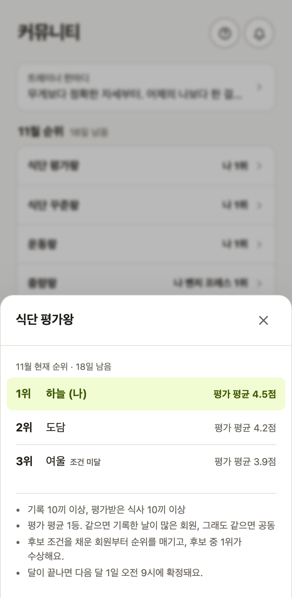
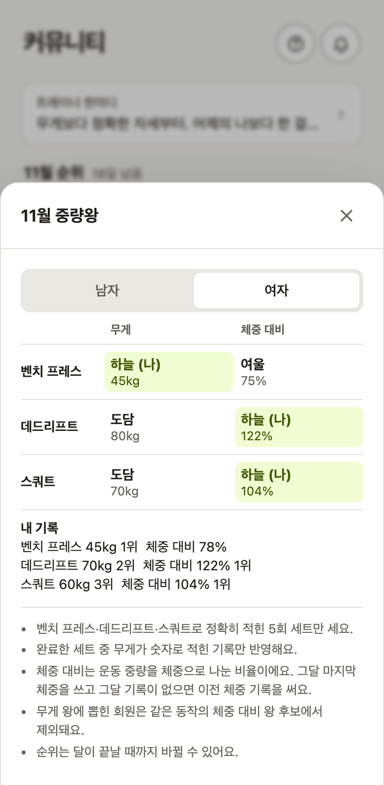

# 참여·비교·공개 — 무엇을 더 기록할지와 어디까지 보여줄지 정합니다

[FITORY](../README.md) / [제품기획 색인](reference/FITORY_제품기획.md#커뮤니티와-참여-규칙)

커뮤니티는 식단·운동 기록을 이어가고 코칭 자료를 나누는 공간입니다. 추천 식단과 운동 팁, 현재 순위와 지난 수상을 제공하며 자유게시판·팔로우·개인 쪽지로 범위를 넓히지 않았습니다. 저는 순위의 결과뿐 아니라 참여 조건, 비교할 기록, 공개할 정보를 함께 정했습니다.

## 후보가 되기 전에도 다음 행동을 알 수 있게 합니다

상위 회원만 보이거나 후보 자격을 채운 뒤에야 순위를 볼 수 있으면, 아직 후보가 아닌 회원은 무엇을 더 해야 하는지 알기 어렵습니다. 저는 11월 5일 후보 전 회원도 순위에 포함하고 남은 기록·평가 수를 보여주도록 정했습니다. 후보는 앞에, 후보 전 회원은 뒤에 구분합니다. 비교할 기록 자체가 없으면 순위를 만들지 않습니다. 운동 기록이 1일 이상이면 현재 순위에 들어오지만, 수상 후보는 8일 이상이어야 합니다.

| 종류 | 후보 조건 | 비교할 값 |
|---|---|---|
| 식단 평가왕 | 해당 월 식단 10끼 이상·평가 10끼 이상 | 평가 평균, 동점이면 기록한 날짜 수 |
| 식단 꾸준왕 | 해당 월 식단 10끼 이상 | 최장 연속 기록일, 동점이면 기록한 날짜 수 |
| 운동왕 | 해당 월 운동한 날 8일 이상 | 운동한 날짜 수. 같은 날 여러 기록을 날짜 수로 중복 계산하지 않음 |

예를 들어 ‘기록 3끼·평가 6끼 더 채우면 후보’라는 안내는 **설명용 예시**입니다. 단순히 낮은 순위만 알리는 대신 후보가 될 조건을 보여줍니다. [현재 후보·순위 계산 SQL](../supabase/migrations/20261105000006_award_standings_all.sql)은 `qualified`를 구분하고 실제 수상은 조건을 채운 후보 중에서 정합니다.

지난달 수상과 이번 달 순위를 15일 기준으로 숨기던 초안도 바꿨습니다. 한 달 내내 지난 결과와 현재 참여를 함께 볼 수 있게 했습니다. 첫 화면은 상별 요약 줄로 두고 눌러 상세를 보게 하여, 여러 단계 탭을 오가던 제안보다 결과와 다음 행동을 먼저 읽게 했습니다. [수상 화면 구현](../src/components/Awards.tsx)

## 같은 조건의 운동 기록끼리 비교합니다

중량왕은 **같은 트레이너의 회원끼리**, 남녀를 나누고 벤치 프레스·데드리프트·스쿼트를 각각 비교합니다. 운동 이름이 일치하고 횟수가 5인 완료 세트 중 숫자로 적힌 중량만 사용합니다. 변형 종목·다른 횟수·`20+5`나 `60-` 같은 기호 표기를 같은 숫자 비교에 넣지 않습니다. 앱 기록은 완료 세트, 시트에서 가져온 과거 기록은 완료로 들어온 세트를 사용합니다.

절대 중량은 가장 높은 중량, 체중 대비는 그 중량을 체중으로 나눈 정수 퍼센트로 비교합니다. 체중은 해당 월 말 또는 조회일 이전의 가장 최근 기록을 쓰며, 같은 날 인바디와 공복 체중이 있으면 인바디를 우선합니다. 체중 기록이 없으면 체중 대비 후보에서 제외합니다. 같은 표시 값은 공동 수상입니다. 세부 계산 기본값은 구현 과정에서 정해진 것으로, 모두 제가 최초 제안한 규칙이라고 귀속하지 않습니다.

[중량 비교 SQL](../supabase/migrations/20261105000004_strength_kings.sql)의 `private.strength_board`는 대상 회원·세트·체중·순위를 단계별로 계산합니다. [화면](../src/components/StrengthKings.tsx)은 두 비교 기준을 나눠 보여줍니다.

## 두 값을 함께 공개할 때 드러나는 정보까지 고려했습니다

한 사람이 같은 운동에서 절대 중량왕과 체중 대비왕이 되면, 다른 회원이 중량을 비율로 나눠 체중을 추정할 수 있습니다. 예를 들어 **100kg과 125%는 80kg을 계산하게 하는 가상 예시**입니다. 저는 동일 종목의 두 상을 겸하지 못하게 정했습니다. 절대 중량왕을 체중 대비 후보에서 제외하고 다음 후보를 뽑으며, 다른 후보가 없으면 해당 칸은 비웁니다.

SQL에는 이 사용자 결정과 이유가 주석으로 남아 있고, `kg_rank > 1` 조건으로 적용되어 있습니다. 다른 종목의 수상이나 다른 공개 정보를 통한 모든 추론을 막는 정책은 아닙니다. 동일 종목에서 두 값을 함께 노출하는 경로를 줄인 결정입니다.

## 기록 공유와 이름·성별 공개를 따로 고릅니다

| 선택 | 화면·참여에 미치는 영향 |
|---|---|
| 식단 공유 동의 | 트레이너가 추천 식단으로 선정할 수 있음. 사진·음식·평가를 공유하고 개인 질문·댓글은 제외 |
| 닉네임 공개 | 끄면 다른 회원에게 익명으로 표시. 본인은 자신의 기록을 알아볼 수 있음 |
| 성별 공개 | 끄거나 아직 성별을 정하지 않으면 성별로 나누는 중량왕 비교에서 제외 |

공유 식단을 허용했다고 개인 대화까지 공개하는 것은 아닙니다. 설정을 하나로 묶지 않아 회원이 각각 선택할 수 있게 했습니다. [공유·수상 설정과 데이터 경로](reference/FITORY_제품기획.md#공유와-비교-참여는-회원이-선택합니다) · [커뮤니티 화면](images/14_community.png)

## 구현과 운영 결과의 범위

위 기준은 2.3 결정 이후 공개된 2.4 코드·화면을 기준으로 설명합니다. 운동왕은 후속 결정에 따라 11월 기록부터 대상으로 바뀌었으며, 초기 기획의 12월 시작이나 15일 이후 순위 노출을 현재 규칙으로 사용하지 않습니다. [시작 월 변경](../supabase/migrations/20261105000007_workout_award_november.sql)

식단왕·운동왕의 확정 수상과 중량왕의 조회 시 계산은 다릅니다. 중량왕은 조회할 때 기록에서 계산하므로 과거 시트·체중 기록을 수정하면 결과도 달라질 수 있습니다. 실제 첫 수상 결과나 참여 증가를 이미 달성한 성과로 제시하지 않습니다. 참여 유도와 비교 조건의 일관성은 설계 목적이며 효과는 별도 측정 대상입니다.
