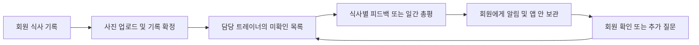
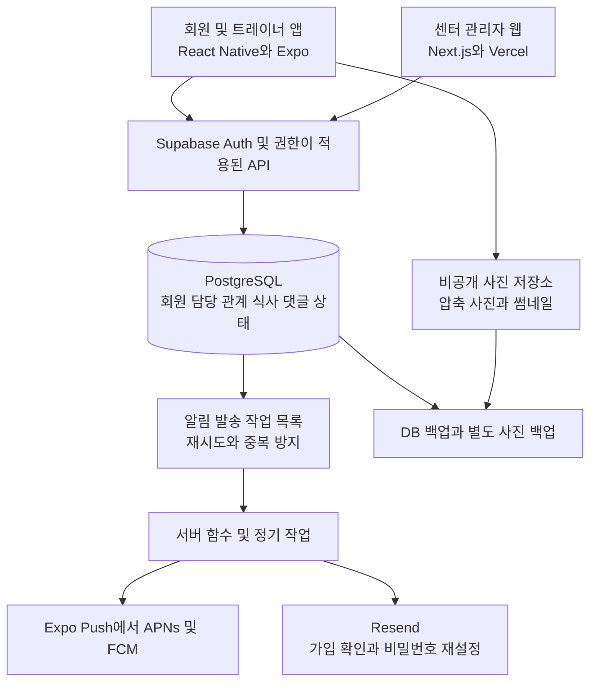

# 회원과 트레이너를 연결하는 식단 관리 앱 개발 기획안

작성일·요금 확인일: **2026년 10월 20일** · 버전: v1.0 · 대상: 서비스 기획자 및 개발 담당자

회원이 언제 무엇을 먹었는지 기록하면 담당 트레이너가 필요한 맥락을 확인하고 피드백하며, 회원이 그 피드백을 확인했는지까지 이어지는 모바일 서비스입니다. 개발 범위, 화면, 운영 흐름, 인프라, 일정과 비용을 정리했습니다.

## 1. 결론

**[설계 제안] 회원과 트레이너가 역할별 화면을 사용하는 하나의 모바일 앱과 센터 관리자용 웹을 구축합니다.** 첫 제품은 식사 기록, 담당자 연결, 미확인 기록 모음, 식사별 대화, 알림에 집중합니다. React Native와 Expo로 모바일을 개발하고, Supabase로 로그인·DB·사진 저장·백엔드 기능을 묶는 구성을 권장합니다. 기록과 관리 상태를 연결해야 한다는 사용자 요구, 사진 업로드와 푸시가 필요한 사용 흐름, 관리형 서비스의 포함 기능을 근거로 한 선택입니다. [Supabase 제공 기능](https://supabase.com/pricing), [Expo 배포 서비스](https://expo.dev/pricing)

트레이너는 회원의 사진뿐 아니라 식사 시각, 음식과 대략적인 양, 관리 목표, 최근 기록, 답변 대기 여부를 함께 받아야 합니다. 앱의 중심 화면을 **오늘 확인할 회원과 아직 처리하지 않은 식사 목록**으로 설계합니다. 사진만으로 칼로리를 확정하는 기능과 자동 처방은 후속 검증 과제로 둡니다.

다음 행동은 실제 사용할 센터의 트레이너와 회원에게 기록 화면과 확인 목록을 보여 주고, 관리 흐름을 검증한 뒤 개발 범위를 확정하는 것입니다. 앱스토어 배포가 필요하면 권장 앱 구성을 선택하고, 사용성 검증과 초기 예산 절감이 우선이면 아래 모바일 웹 대안을 선택합니다.

## 2. 기획 및 산정의 전제

아래는 아직 사용자가 확정하지 않은 **계획 가정**입니다. 단가와 제품 정책의 가정은 업체가 발표한 사실과 구분합니다.

| 항목 | 초기 기준 |
|---|---|
| 이용 형태 | 국내 PT센터가 기존 회원을 관리하는 서비스 |
| 초기 규모 | 회원 100명, 트레이너 5명, 센터 1곳 |
| 지원 기기 | iPhone·Android, 관리자용 PC 및 모바일 웹 |
| 초기 대상 | 성인 회원, 담당 트레이너가 있는 이용자 |
| 연결 방식 | 초대코드·링크로 센터 가입 후 관리자가 담당 트레이너 배정 |
| 담당 관계 | 회원당 주 담당 트레이너 1명, 트레이너는 여러 회원 관리 |
| 초기 기록 | 하루 평균 3식, 식사당 사진 1장, 음식명·대략적인 양·식사 시각 |
| 선택 기록 | 체중, 목표, 배고픔 정도·특이사항 등 필요한 항목만 |
| 보관 정책 가정 | 사진은 최근 180일 유지. 기간 종료 전 내보내기 안내와 삭제 절차 제공 |
| 수익·결제 범위 | 센터의 기존 관리에 사용. 초기 앱 안에서 결제하지 않음 |
| 금액 기준 | 부가세·환전 및 해외 결제 수수료 별도 |
| 원화 환산 | **예산 계산용 USD 1 = 1,500원**. 실시간 환율이나 환율 전망이 아님 |

여러 독립 트레이너가 가입하는 사업으로 확장한다면 트레이너 검증, 입점·구독, 계약·정산, 분쟁 처리와 개인정보 제공 구조를 추가해야 합니다. 현재 개발비는 그 기능을 포함하지 않습니다.

## 3. 사용자별 기능과 권한

| 사용자 | 주요 기능 | 접근 범위 |
|---|---|---|
| 회원 | 식사 기록·수정, 과거 식사 등록, 내 기록 달력, 피드백 확인·추가 질문, 선택적 체중 기록, 알림 설정·탈퇴 | 본인 기록과 본인이 참여하는 대화 |
| 트레이너 | 담당 회원 목록, 미확인 식사, 회원별 추이, 식사별 피드백, 일간 총평, 재사용 답변 문구, 목표 설정 | 유효한 담당 관계와 허용된 관리 기간의 회원 기록 |
| 센터 관리자 | 초대, 담당자 배정·변경, 소속·계정 관리, 응답 지연·신고 확인 | 소속 센터의 운영 정보. 건강 기록 열람은 별도 업무 권한이 있을 때만 |
| 서비스 운영자 | 오류·신고·계정 지원, 청구·사용량 관리 | 업무에 필요한 최소 정보. 식사 내용은 기본 관리 화면에서 숨김 |

**[설계 제안] 트레이너 권한은 사용자가 가입 화면에서 직접 선택해 얻지 못하게 합니다.** 센터 관리자의 초대·승인으로 부여하고, 관리자 권한 변경과 지원 목적의 기록 열람은 이력으로 남깁니다. 센터가 늘어나도 다른 센터의 회원 데이터가 섞이지 않도록 최초 DB부터 소속 센터 구분을 둡니다.

## 4. 회원 기록이 트레이너 관리로 이어지는 흐름

### 4.1 회원 기록

회원이 사진을 찍거나 선택하고, 실제 식사 시각·식사 구분·음식명·대략적인 양을 입력합니다. 기본값은 현재 시각이며 과거 식사도 등록할 수 있습니다. 사진 없이 텍스트만 등록하는 경로도 제공합니다. 사진의 촬영 시각이나 업로드 시각을 실제 식사 시각으로 단정하지 않습니다.

예를 들어 회원이 저녁에 `12:30 / 점심 / 밥 반 공기, 닭가슴살 1팩 / 사진`을 등록하면 점심 기록에 배치합니다. 트레이너에게는 방금 올라온 미확인 기록으로 표시합니다. 식사 시각과 등록 시각을 각각 저장해야 이 동작이 가능합니다.

네트워크가 끊기면 임시 저장 상태를 유지하고 재시도합니다. 서버가 저장을 확정하기 전까지 완료로 표시하지 않으며, 반복 탭과 재전송이 같은 식사 기록을 중복 생성하지 않게 합니다.

### 4.2 트레이너에게 전달하는 정보

| 화면의 정보 | 관리에서 필요한 이유 |
|---|---|
| 회원 이름·주 담당자·현재 목표 | 누구에게 어떤 목표로 피드백하는지 식별 |
| 실제 식사 일시·종류·음식명·양·사진 | 언제 무엇을 먹었는지 파악 |
| 회원이 남긴 질문과 메모 | 추가 답변이 필요한 기록 식별 |
| 오늘 다른 식사와 최근 7일 기록 | 한 끼를 하루·주간 흐름 안에서 확인 |
| 선택적으로 입력한 체중 추이 | 회원이 동의한 범위의 변화 확인 |
| 미확인 경과 시간·최근 피드백 | 관리 누락과 반복 질문 방지 |
| 기록이 없는 날 | 연락이 필요한지 판단. 실제 결식으로 판정하지 않음 |

**[설계 제안] 우선순위는 설명 가능한 운영 규칙으로 정합니다.** 회원의 추가 질문, 응답 기준 시간을 넘긴 기록, 장기간 미기록 회원을 위로 올립니다. 이 표시는 관리 알림이며 건강 위험 점수가 아닙니다. 초기에는 검증되지 않은 영양 점수로 회원을 자동 평가하지 않습니다.

### 4.3 피드백과 양방향 소통

트레이너는 식사에 댓글을 남기거나 하루 식사를 묶어 총평합니다. `확인했습니다` 버튼과 `피드백 전송`을 구분하고, 식사를 열어 본 것만으로 처리 완료가 되지 않게 합니다. 일간 총평을 작성하면 그 총평이 다루는 식사들이 무엇인지 회원과 트레이너 모두 확인할 수 있어야 합니다.

회원은 해당 식사에서 추가 질문을 남기며, 그 질문은 트레이너의 답변 대기로 돌아옵니다. 별도의 범용 메신저 대신 **식사 기록에 연결된 대화**를 초기 소통 방식으로 사용합니다. 이는 사용자의 핵심 요구인 식단 관리를 기준으로 개발 범위를 좁힌 선택입니다. 일반 상담 채팅·음성·영상은 다음 단계에서 판단합니다.

### 4.4 관리 상태와 알림 규칙

| 상태 | 의미 | 다음 동작 |
|---|---|---|
| 전송 중·실패 | 아직 서버에 식사 기록 확정 전 | 재시도 또는 수정 |
| 확인 대기 | 기록 확정, 트레이너의 명시적 처리 전 | 확인 목록에 유지 |
| 확인 완료 | 트레이너가 검토를 명시적으로 표시 | 피드백 필요 여부 표시 |
| 피드백 도착 | 트레이너가 답변 전송 | 회원 알림함에 보관 |
| 추가 질문 | 회원이 답변을 요청 | 트레이너의 답변 대기로 복귀 |

열람 이력과 관리 상태는 별도로 기록합니다. 피드백 후 음식·사진·시각을 수정하면 `수정됨` 표시와 변경 버전을 남기고 다시 확인 대상으로 올립니다. 읽지 않은 댓글을 상태 변경으로 지우지 않습니다.

알림 초안은 다음과 같습니다. 시간·횟수는 파일럿에서 조정할 제품 정책입니다.

- 트레이너: 새 식사는 알림함에 즉시 쌓고, 푸시는 30분 단위로 묶어 보냅니다. 같은 식사에 반복 알림을 보내지 않습니다.
- 회원: 피드백·질문에는 알림을 보내고, 기록 리마인더는 동의한 사용자에게 하루 최대 1회 제공합니다.
- 운영: 담당 트레이너의 근무일 기준 다음 근무일 종료까지 응답하는 기준을 제안합니다. 휴무일·센터 운영시간을 함께 설정합니다.
- 푸시 거부·전송 실패 시에도 앱 안 알림함과 확인 목록으로 관리가 이어집니다. 푸시 접수 성공을 회원 열람으로 취급하지 않습니다.

Expo 공식 문서는 푸시 발송이 무료이며, 하위 Apple·Google 알림 서비스로의 전달이 중복되거나 실패할 수 있다고 설명합니다. 따라서 알림은 보조 경로로 사용하고, 관리 상태의 기준은 DB에 둡니다. [Expo 푸시 비용과 전달 조건](https://docs.expo.dev/push-notifications/faq/)

## 5. 첫 출시 범위와 화면

### 5.1 기능 우선순위

| 우선순위 | 기능 | 완료 기준 |
|---|---|---|
| 필수 | 이메일 가입·로그인, 초대·담당자 배정 | 일반 회원이 트레이너 권한을 얻을 수 없으며 배정 회원만 조회 |
| 필수 | 식사 등록·수정·삭제, 사진·시각·음식·양 | 느린 네트워크에서도 상태가 분명하며 재시도 중복 없음 |
| 필수 | 트레이너 확인 목록·회원별 타임라인 | 오래된 미확인 기록과 추가 질문을 빠짐없이 노출 |
| 필수 | 식사별 댓글·질문, 일간 총평 | 대화 맥락 유지, 회원과 트레이너 양쪽의 미응답 표시 |
| 필수 | 알림함·푸시·알림 설정 | 푸시를 꺼도 앱 기능 사용 가능 |
| 필수 | 날짜별 기록·목표·기본 추이 | 기록 없음과 실제 식사하지 않음을 구분 |
| 필수 | 관리자 웹·담당자 변경·신고 처리 | 담당 해제 후 새 데이터 접근 차단, 지원 열람 이력 저장 |
| 필수 | 동의·탈퇴·내보내기·신고·차단 | 본인 데이터 관리와 운영자의 대응 경로 제공 |
| 후속 | 카카오·Apple 로그인, 음식 검색 DB | 반복 입력의 불편을 실제로 확인한 뒤 우선 적용 |
| 후속 | 식품별 영양정보, 주간 리포트 | 출처·입력량·불확실성을 표시할 수 있을 때 도입 |
| 후속 | AI 음식 후보·양 입력 보조·답변 초안 | 회원 또는 트레이너의 확인·수정 후 확정 |
| 확장 | 범용 상담 채팅·결제·여러 센터 운영 | 실제 고객과 사업 모델 확정 후 견적 산정 |

앱스토어 제출을 고려해 사용자 게시물 신고·차단·부적절한 콘텐츠 대응과 앱 내 계정 삭제를 초기 작업에 넣습니다. 게시물 필터링 방식과 운영 담당자도 정해야 합니다. 결제 기능을 추가할 때에는 디지털 구독과 실시간 개인 간 서비스의 적용 규칙을 상품별로 확인해야 하며, 비동기 식단 피드백을 실시간 PT 예외에 자동으로 포함시키지 않습니다. [Apple 심사 지침 1.2, 3.1, 5.1.1](https://developer.apple.com/app-store/review/guidelines/)

### 5.2 화면 구성

| 사용자 | 화면 | 주요 내용 |
|---|---|---|
| 공통 | 시작·로그인·센터 연결 | 이메일 확인, 초대, 동의, 알림 권한 안내 |
| 회원 | 오늘 | 오늘 식사, 등록 버튼, 새 피드백, 관리 목표 |
| 회원 | 식사 등록·상세 | 사진, 실제 식사 시각, 음식·양, 댓글·질문 |
| 회원 | 기록 | 달력·일별 타임라인·선택적 체중 추이 |
| 트레이너 | 확인할 항목 | 미확인·응답 지연·추가 질문, 회원 필터 |
| 트레이너 | 담당 회원·상세 | 목표, 최근 기록, 식사 상세, 일간 총평 |
| 공통 | 알림함·설정 | 알림 설정, 담당 관계, 내보내기, 신고·차단, 탈퇴 |
| 관리자 웹 | 회원·담당자·운영 | 초대, 배정, 지연 현황, 신고, 접근 이력 |

## 6. 구현 방식 비교와 선택

아래 기간과 개발비는 **기능 범위를 전제로 한 자체 계획 추정**이며 업체 견적·시장 평균이 아닙니다. 앱 개발비의 상세 계산은 9절에 있습니다. 모바일 웹은 아래처럼 범위를 줄였을 때의 별도 추정입니다.

| 선택 기준 | 모바일 웹 및 PWA | React Native 앱 및 관리자 웹 |
|---|---|---|
| 회원이 시작하는 방법 | 링크로 접속, 홈 화면 추가 가능 | App Store·Google Play에서 설치 |
| 식사 기록·대화 | 웹에서 구현 | 모바일 앱에서 구현 |
| 카메라·알림 경험 | 브라우저·OS별 확인 필요. iOS 웹 푸시는 홈 화면 추가 등 조건 있음 | 모바일 사진 선택·기기 푸시 중심으로 구현. 권한·OS 정책 영향은 존재 |
| 배포와 수정 | 웹 배포 중심 | 스토어 배포 및 앱 빌드·업데이트 관리 |
| 축소 MVP 작업량 | 개발 1.5~2인월, 기획·디자인·QA 합산 300~750만원 가정 | 개발·기획·디자인·QA 상세는 9절 |
| 초기 개발 예산 | 약 1,600만~3,000만원, 예비비 포함 | 약 3,300만~6,600만원, 예비비 포함 |
| 개발 기간 가정 | 약 5~8주 | 약 10~14주 |
| 선택할 조건 | 링크로 참여 가능한 소규모 검증이 우선 | 반복 촬영·알림과 정식 모바일 배포가 우선 |

iOS·iPadOS 16.4부터 홈 화면 웹앱에서 웹 푸시를 지원하며, 사용자 동작에 따른 권한 요청이 필요합니다. 따라서 PWA도 대안이지만 설치·권한 안내를 실제 회원 기기로 검증해야 합니다. [WebKit 웹 푸시 조건](https://webkit.org/blog/13878/web-push-for-web-apps-on-ios-and-ipados/)

**[설계 제안] 목표 제품은 React Native 앱으로 선택합니다.** 웹 MVP를 택하는 경우에는 최초 고객의 사용 지속성을 확인하는 별도 검증안으로 취급합니다. 이후 앱을 만들 때 DB·업무 규칙은 재사용할 수 있지만 화면과 기기 기능은 추가 작업이 필요하므로 두 개발비를 동일하게 보지 않습니다.

## 7. 필요한 인프라

### 7.1 권장 구성

| 인프라 | 역할 | 초기 선택과 이유 |
|---|---|---|
| 모바일 | 회원·트레이너용 화면과 촬영 | React Native·Expo. 한 모바일 코드 기반에서 역할별 화면 구성 |
| 관리자 웹 | 초대·배정·운영 대응 | Next.js·Vercel Pro. 회원 앱과 같은 인증·DB 사용 |
| DB | 회원·담당 관계·식사·댓글·확인 상태 | Supabase PostgreSQL. 관계와 기간에 따른 조회를 명시적으로 설계 |
| 로그인 | 계정·세션·가입 확인 | Supabase Auth, 초기 이메일 방식. 문자 인증은 별도 비용이 드는 후속 선택 |
| 사진 저장소 | 식단 사진·썸네일 | Supabase Storage 비공개 버킷. 앱은 사용자 권한에 따라 업로드·조회 |
| 서버 처리 | 권한 변경, 기록 확정, 알림·삭제 | Supabase 서버 함수·DB 트랜잭션·정기 작업 |
| 대화 갱신 | 댓글·피드백 변경 반영 | Supabase Realtime, 화면 재진입 시 DB 재조회로 누락 보정 |
| 푸시 | 피드백·확인 대기 안내 | Expo Push → APNs·FCM. 메시지 본문에는 식사·체중 정보를 넣지 않음 |
| 메일 | 가입 확인·비밀번호 재설정 | Resend를 사용자 발송용 SMTP로 연결 |
| 장애 감시 | 오류·발송 실패·응답시간 | 앱 오류 수집, 서버 로그, 업타임 확인. 요금과 개인정보 마스킹을 함께 설정 |
| 백업 | 실수·장애 시 복구 | DB 자동 백업과 별도 객체 저장소 사진 증분 백업 |
| 배포 | 앱 빌드·웹 배포·릴리스 이력 | EAS, Git 저장소·CI, Vercel. 개발·검증·운영 환경 분리 |
| 도메인·보안 | 서비스 주소·인증·운영 계정 | 도메인·TLS, 서비스 비밀키 관리, 관리자 다중 인증 |

Supabase는 서울 특정 리전인 `ap-northeast-2`를 제공합니다. 국내 회원을 대상으로 한다는 가정에서 이 리전을 선택합니다. 일반 APAC 그룹은 다른 국가에 배치될 수 있으므로 서울을 직접 지정합니다. [리전과 데이터 위치](https://supabase.com/docs/guides/platform/regions)

메일은 출시 전에 별도로 연결해야 합니다. Supabase 기본 SMTP는 운영용이 아니며 수신 대상 등에 제약이 있어 회원 가입 메일을 그대로 맡길 수 없습니다. 발송 도메인 인증과 서비스별 속도 제한도 함께 설정합니다. [Supabase SMTP 안내](https://supabase.com/docs/guides/auth/auth-smtp)

### 7.2 최소 데이터 구조

| 데이터 | 핵심 항목 |
|---|---|
| 사용자·소속 | 사용자 ID, 역할, 센터, 활성 상태 |
| 담당 관계 | 회원·트레이너 ID, 센터, 시작·종료일, 기록 공유 범위 |
| 식사 | 회원·센터 ID, 실제 식사 시각, 등록 시각, 종류, 음식·양, 메모, 버전, 중복 방지 키 |
| 사진 | 식사 ID, 소유자, 저장 경로, 크기, 처리 상태, 보관 만료일 |
| 피드백·댓글 | 식사 또는 일간 총평 ID, 작성자, 내용, 시각, 수정 이력 |
| 관리 상태 | 식사·담당자·식사 버전, 확인 시각, 피드백 대상, 미응답 상태 |
| 목표·선택 지표 | 목표와 적용 기간, 회원이 제공한 체중 등, 동의 범위 |
| 알림 | 수신자, 관련 기록 ID, 앱 내 읽음, 발송·실패·재시도 상태 |
| 동의·운영 이력 | 동의 항목·문서 버전·시각, 담당자 변경, 지원 열람, 삭제 요청 |

시간은 서버에 일관된 형식으로 저장하고 사용자 화면에서 시간대에 맞게 표시합니다. 회원별 날짜 검색, 트레이너별 미확인 검색에 필요한 인덱스와 페이지 단위 조회를 처음부터 적용합니다.

### 7.3 누락·장애·권한 처리

- 식사 확정과 알림 작업 생성은 같은 DB 트랜잭션으로 기록합니다. 알림 서버가 잠시 실패해도 작업을 다시 읽어 처리할 수 있게 합니다.
- 업로드가 끝나지 않은 식사는 트레이너의 완료된 기록으로 노출하지 않습니다. 저장 후 연결되지 않은 임시 사진은 정기적으로 정리합니다.
- 계정 ID를 바꿔 요청하더라도 다른 회원의 식사·댓글·사진에 접근하지 못하게 서버와 DB의 행별 접근 규칙을 적용합니다. 서비스 비밀키는 앱에 넣지 않습니다.
- 담당자 해제·센터 이동 시 새 조회 권한을 즉시 해제합니다. 이미 발급한 사진 URL은 짧게 만료시킵니다. 예를 들어 5분 만료라면 기존 URL은 최대 그 시간까지 남을 수 있으므로, 즉시 차단이 필요할 때는 인증을 매번 확인하는 다운로드 경로를 사용합니다.
- 개발·검증 환경에는 실제 회원 식사 대신 가상 데이터를 사용합니다. 가격 모델은 운영 DB 1개와 유료 검증 DB 1개를 포함합니다.
- 초기 복구 목표는 데이터 손실 최대 24시간, 복구 4~8시간으로 제안합니다. 이는 업체의 보장이 아니라 자체 목표이며 복구 훈련으로 검증해야 합니다.

## 8. 인프라 비용

### 8.1 공식 기본요금

모든 단가의 확인일은 **2026-10-20**입니다. 공급사가 요금을 변경할 수 있으므로 실제 계약 직전 다시 확인합니다.

| 항목 | 확인한 기본요금·포함량 | 비용 산정에 적용한 방식 |
|---|---|---|
| Supabase Pro | 월 USD 25부터. 컴퓨트 크레딧 USD 10, DB 8GB·파일 100GB·일반 전송 250GB 등 포함 | 운영 Micro 1개이면 USD 25, 별도 검증 Micro 약 USD 10 추가. [가격](https://supabase.com/pricing) |
| 추가 DB 처리 용량 | 월 환산 Micro 약 USD 10, Medium 약 USD 60, Large 약 USD 111. 실제 시간 단위 청구 | 운영 부하를 가정해 단계별로 선택. 동일 조직의 크레딧을 이중 차감하지 않음. [컴퓨트 단가](https://supabase.com/docs/guides/platform/manage-your-usage/compute) |
| 사진 저장 초과 | 포함량 초과 GB당 월 USD 0.0213 | 보관량이 유지된 월말 규모로 보수적으로 계산. 실제는 GB·시간 기준. [저장 단가](https://supabase.com/docs/guides/platform/manage-your-usage/storage-size) |
| 외부 전송 초과 | 일반 전송 GB당 USD 0.09, 캐시 전송은 별도 포함량·단가 | 아래 모델은 전부 일반 전송으로 계산. [가격](https://supabase.com/pricing) |
| Vercel Pro | 월 USD 20부터, 추가 개발자 좌석·사용량에 추가 비용 | 개발자 1좌석 기준. 트레이너는 앱 사용자이므로 이 좌석에 포함하지 않음. [가격](https://vercel.com/pricing) |
| Expo EAS Starter | 월 USD 19＋초과 사용량, 빌드 크레딧 USD 45, 업데이트 MAU 3천 포함 | 초기·1천 회원 시 적용. 푸시 요금과 별개. [가격](https://expo.dev/pricing) |
| Expo EAS Production | 월 USD 199＋초과 사용량, 업데이트 MAU 5만 포함 | 1만 회원에서 업데이트 대상 수를 고려해 편성한 선택. 가입 회원 수만으로 자동 전환되는 정책은 아님. [가격](https://expo.dev/pricing) |
| 푸시 발송 | Expo Push 발송 무료 | 서버 함수 실행·작업 저장 비용은 포함량과 사용량에 반영. [푸시 안내](https://docs.expo.dev/push-notifications/faq/) |
| Resend 이메일 | 무료 월 3천 통·하루 100통, Pro 월 USD 20·5만 통 | 100회원은 무료 한도 내, 1천·1만 회원은 가입 집중을 고려해 Pro 편성. [가격](https://resend.com/pricing) |
| DB 자동 백업 | Pro에서 일별 백업 7일 보관 | 사진 파일은 제외되므로 아래 별도 예산 사용. [백업 범위](https://supabase.com/docs/guides/platform/backups) |

Vercel Hobby는 비상업적 개인 용도로 제한됩니다. 센터 운영 예산은 Pro로 계산했습니다. [Hobby 이용 범위](https://vercel.com/docs/plans/hobby)

### 8.2 사진과 트래픽 산정

**[산정 가정]** 사진 0.4MB＋미리 만든 썸네일 0.05MB, 식사당 합계 0.45MB로 저장합니다. 앱에서 압축하고 서버에서 형식·용량을 검증합니다. 사진 1장/식, 하루 3식, 30일/월, 사진 보관 180일을 적용합니다. MB→GB는 1,000 기준입니다.

월 전송량은 식사당 저장된 이미지 묶음을 회원·트레이너가 합계 2회 읽고, 별도 백업에 1회 복사하는 **총 3회 전송**으로 가정합니다. 캐시 할인은 계산에서 제외합니다. 사진을 반복해서 확대하거나 여러 장 올리면 사용량이 늘어납니다. 일별 백업은 새 파일만 복사하고 전체 사진을 매일 다시 내려받지 않습니다.

| 사용량 | 회원 100명 | 회원 1,000명 | 회원 10,000명 |
|---|---:|---:|---:|
| 트레이너 수 가정 | 5명 | 50명 | 500명 |
| 월 식사 기록 | 9,000건 | 90,000건 | 900,000건 |
| 월 신규 이미지 | 4.05GB | 40.5GB | 405GB |
| 180일 누적 저장 | 24.3GB | 243GB | 2,430GB |
| 월 전송량 가정 | 12.15GB | 121.5GB | 1,215GB |
| 사진 저장 초과 비용 | USD 0 | 약 USD 3.05 | 약 USD 49.63 |
| 일반 전송 초과 비용 | USD 0 | USD 0 | 약 USD 86.85 |

계산식은 `저장 GB = 회원 수 × 3식 × 180일 × 0.45MB ÷ 1,000`, `전송 GB = 회원 수 × 3식 × 30일 × 0.45MB × 3회 ÷ 1,000`입니다. 저장 단가는 [공식 Storage 문서](https://supabase.com/docs/guides/platform/manage-your-usage/storage-size), 전송 단가는 [공식 가격표](https://supabase.com/pricing)를 적용했습니다. 첫 달은 180일 누적 전이므로 실제 저장 과금은 이 모델보다 작을 수 있습니다.

### 8.3 규모별 월 예산

**아래는 공급사의 패키지 견적이 아니라, 확인한 단가와 위의 사용량 가정을 결합한 예산 모델입니다.** 사용자 수만으로 DB 처리 용량이 보장되지는 않으며, 실제 동시접속·조회 방식에 따른 부하 시험이 필요합니다.

| 항목, 월 USD | 회원 100명 | 회원 1,000명 | 회원 10,000명 |
|---|---:|---:|---:|
| Supabase 플랜·운영 및 검증 컴퓨트 | 35 | 85 | 136 |
| 사진 저장 초과 | 0 | 3.05 | 49.63 |
| 일반 전송 초과 | 0 | 0 | 86.85 |
| 관리자 웹·호스팅 | 20 | 20 | 40 |
| 앱 빌드·업데이트 | 19 | 19 | 199 |
| 이메일 | 0 | 20 | 20 |
| 모니터링·사진 백업 예산 | 15 | 25 | 80 |
| DB·함수·로그 등 기타 사용량 여유 | 0 | 15 | 50 |
| 도메인 월 환산 예산 | 2 | 2 | 2 |
| **합계, 반올림** | **91** | **189** | **663** |
| **원화, 1,500원 환산** | **약 13.7만원** | **약 28.4만원** | **약 99.5만원** |
| 모델 합계에 30% 예비비 적용 | 약 17.7만원 | 약 36.9만원 | 약 129.4만원 |
| **권장 월 인프라 편성 범위** | **15만~25만원** | **30만~45만원** | **110만~160만원** |

표의 모니터링·사진 백업·도메인·기타 사용량 여유는 **계획용 예산 배정액이며 특정 상품의 확정 요금이 아닙니다.** 별도 객체 저장소의 보관·요청료와 작업 실행료를 이 예산 안에서 선정하고, 실제 견적이 넘으면 수정합니다. 1만 회원의 웹 비용 USD 40은 Pro 기본료와 사용량 여유 USD 20의 합입니다. 서버 규모는 초기 Micro, 1천 회원 Medium, 1만 회원 Large를 가정했고 모두 검증 Micro 1개를 추가했습니다. 컴퓨트 월 환산은 실제 청구 시간에 따라 달라집니다.

사진 백업은 DB 백업으로 대체되지 않습니다. Supabase는 DB 백업에 Storage API 객체 파일이 포함되지 않는다고 명시합니다. 별도 사진 백업과 DB의 파일 목록이 함께 복구되는지 확인해야 합니다. [공식 백업 범위](https://supabase.com/docs/guides/platform/backups)

### 8.4 배포 계정과 추가 비용

| 항목 | 금액·처리 |
|---|---|
| Apple 개발자 계정 | 연 USD 99, 계획 환산 약 14.9만원. 지역별 실제 결제 금액 확인. [가입 안내](https://developer.apple.com/programs/enroll/) |
| Google Play 개발자 계정 | 최초 1회 USD 25, 계획 환산 약 3.8만원. [가입 안내](https://support.google.com/googleplay/android-developer/answer/6112435?hl=en) |
| 두 계정 첫해 합계 | USD 124, 계획 환산 18.6만원. 월 인프라 표와 별도 |
| 실기기·개발 장비 | 기존 Mac·iPhone·Android 기기 활용 가정. 신규 구매비 별도 |
| 문자·알림톡 | 초기 미사용. 발송 사업자·본인확인 여부·건수 결정 후 추가 |
| AI·유료 영양 DB | 초기 미사용. 기능·계약·재시도 포함 사용량을 정한 후 추가 |
| 결제 수수료 | 초기 미사용. 상품별 스토어·결제 정책 확인 후 추가 |
| 보안 점검·약관 검토 | 수행 범위와 업체 확정 후 별도 견적 |

소스 저장소, 스토어 계정, 클라우드 계정과 도메인은 서비스 운영 주체 소유로 개설합니다. 외주 개발자에게는 필요한 권한만 부여하고 소스·배포 키·운영 문서를 인수합니다.

## 9. 개발비와 유지보수비

### 9.1 정식 앱 MVP 개발비

**[산정 가정]** 숙련 개발자 2명이 앱과 백엔드·웹 작업을 나누고, 기획·디자인·QA가 필요한 시기에 참여하는 형태입니다. 인월은 한 사람이 한 달 투입하는 작업량입니다. 아래 단가는 계획 산정을 위한 입력값이며 실제 외주 단가나 통계가 아닙니다.

| 역할 | 작업량 가정 | 인월 단가 가정 | 비용 |
|---|---:|---:|---:|
| 기획·PM | 0.5~0.75인월 | 600만~800만원 | 300만~600만원 |
| UX·UI 디자인 | 0.5~0.75인월 | 600만~800만원 | 300만~600만원 |
| 앱·백엔드·관리자 웹 개발 | 3~4.5인월 | 700만~900만원 | 2,100만~4,050만원 |
| QA·배포 검증 | 0.5~0.75인월 | 400만~600만원 | 200만~450만원 |
| 합계 |  |  | 2,900만~5,700만원 |
| 변경·보완 예비비 15% |  |  | 435만~855만원 |
| **개발 예산** |  |  | **3,335만~6,555만원, 약 3,300만~6,600만원** |

이 예산은 5절의 필수 기능, 기본적인 운영 문서와 스토어 제출 대응을 전제로 합니다. 범용 채팅, 유료 결제, AI 분석, 전문 영양 DB, 법률·보안 전문기관의 외부 검토는 추가 범위입니다. 하자 수정 기간과 이후 기능 개선비를 계약에서 구분해야 합니다.

직접 개발하면 외주 현금 지출을 줄일 수 있지만, 설계·기기 시험·배포·장애 대응에 투입하는 본인의 시간은 필요합니다. AI 보조 개발 도구의 구독료가 위 전체 개발비를 대체한다고 계산하지 않습니다.

### 9.2 월 유지보수와 트레이너 업무

**[산정 가정]** 출시 후 오류 대응·의존성 및 OS 업데이트·백업 복구 점검에 월 8~20시간, 시간당 8만~12만원을 배정하면 **월 64만~240만원**입니다. 신규 기능 개발과 상시 긴급 대응 계약은 별도입니다. 자체 개발자가 담당해도 그 시간이 소요됩니다.

트레이너의 피드백 노동과 고객 문의 대응은 인프라 비용에 포함되지 않습니다. 예를 들어 트레이너가 회원 20명의 하루 3식에 각각 1분을 쓰면 하루 60분이 필요합니다. 회원별 하루 총평을 2분씩 작성하는 가정에서는 40분입니다. 이 차이는 실제 생산성 향상을 증명하는 수치가 아니라 **확인 목록·총평 기능을 실험할 이유를 보여 주는 계산 예시**입니다.

### 9.3 초기 100명 규모의 첫해 예산 예시

| 비용 | 계산 | 금액 |
|---|---|---:|
| 일회성 개발 | 상세 모델, 예비비 포함 | 3,335만~6,555만원 |
| 인프라 12개월 | 월 15만~25만원 × 12 | 180만~300만원 |
| 유지보수 12개월 | 월 64만~240만원 × 12 | 768만~2,880만원 |
| 개발자 계정 첫해 | 계획 환산, 반올림 | 약 19만원 |
| **합계** | 항목 합산 | **약 4,300만~9,800만원** |

출시 이후 12개월을 운영하는 비교용 모델입니다. 초기 개발 기간에도 발생하는 일부 클라우드 비용, 부가세·환전 수수료, 신규 장비, 트레이너 인건비, 마케팅·고객 지원·전문 검토 비용은 별도입니다.

## 10. 일정과 출시 판단

### 10.1 약 12주 기준 일정

| 기간 | 작업 | 확인할 산출물 |
|---|---|---|
| 1~2주 | 실제 회원·트레이너 인터뷰, 업무 규칙·우선순위, 화면 흐름 | 요구사항·권한표·클릭 가능한 화면 시안 |
| 3~4주 | 디자인, 계정·센터·담당 관계, DB·접근 규칙, 배포 환경 | 초대와 로그인, 권한을 검증할 수 있는 기반 |
| 5~7주 | 식사 기록·사진·타임라인·트레이너 확인 목록 | 회원 기록이 담당자 화면에 전달되는 기능 |
| 8~9주 | 식사별 대화·일간 총평·알림·관리자 웹 | 기록에서 피드백·추가 질문까지의 전체 흐름 |
| 10주 | 실기기·권한·복구·삭제·업로드 실패 시험 | 주요 결함 수정, 스토어 제출 자료 |
| 11~12주 | 회원 20~30명·트레이너 2~3명 파일럿, 보완·제출 | 사용성 지표·운영 매뉴얼·릴리스 후보 |

10~14주는 이 인력과 기능을 전제로 한 계획 기간입니다. 스토어 계정 확인·테스트 자격·심사와 재심사 기간은 별도로 달라질 수 있으므로 출시일을 보장하지 않습니다. 파일럿은 운영 주체가 모집하고 실제 사용 데이터 수집 동의를 받아 진행합니다.

### 10.2 성공 기준 제안

다음 수치는 외부 서비스 평균이 아니라 **파일럿에서 합의할 목표 초안**입니다.

| 지표 | 정의 | 목표 초안 |
|---|---|---|
| 첫 기록 활성화 | 초대 수락 후 24시간 내 식사 1개 이상 등록한 회원 비율 | 70% 이상 |
| 주간 기록 지속 | 파일럿 전체 회원 중 주 4일 이상 기록한 회원 비율 | 60% 이상 |
| 관리 응답 준수 | 기준 시간 내 트레이너가 명시적으로 검토 또는 피드백한 기록 비율 | 90% 이상 |
| 피드백 도달 후 확인 | 피드백 생성 후 24시간 내 앱에서 확인한 회원 비율 | 70% 이상 |
| 입력 부담 | 식사 등록을 시작한 뒤 서버가 확정할 때까지의 중앙값 | 30초 이내 목표 |
| 트레이너 업무량 | 담당 회원당 검토·답변에 쓴 시간 | 파일럿 전후 실측으로 판단 |

표본이 작으므로 비율뿐 아니라 인원과 중도 이탈 이유를 함께 봅니다. 체중 감소나 건강 개선 효과는 이 사용성 지표로 입증할 수 없습니다.

### 10.3 출시 전 필수 검증

핵심 업무의 실패를 중심으로 시험합니다. 다른 회원·다른 센터 데이터 접근, 담당자 해제, 업로드 중 앱 종료와 재시도, 식사 수정 후 재확인, 알림 실패와 추가 질문 누락을 반드시 포함합니다. iPhone·Android 실기기에서 카메라·사진 권한 거부, 백그라운드 복귀, 로그아웃·세션 만료도 확인합니다.

DB와 사진을 함께 복구하는 훈련, 회원 내보내기·탈퇴 후 원본과 백업의 처리, 신고·차단 대응을 실제 운영 절차로 확인합니다. 가상 부하로 미확인 목록·회원 타임라인·사진 업로드를 시험한 뒤 DB 컴퓨트 예산을 조정합니다.

## 11. 개인정보와 운영 설계

### 11.1 수집 항목과 동의

건강에 관한 정보는 개인정보 보호법 제23조의 민감정보에 포함되며, 법령상 허용 등의 근거가 없는 경우 다른 개인정보 동의와 별도의 동의가 필요합니다. 체중·체성분·질환·알레르기 등을 실제로 수집한다면 항목별 성격과 근거를 검토합니다. 음식 사진 전체를 일률적으로 법적 민감정보라고 단정하지 않고, 건강정보와 결합한 사용 맥락을 확인합니다. [개인정보 보호법 제23조, 2026-09-11 시행본](https://www.law.go.kr/LSW/lsSideInfoP.do?lsiSeq=283839&joNo=0023&joBrNo=00&docCls=jo&urlMode=lsScJoRltInfoR)

**[설계 제안]** 첫 출시에는 질환·투약·검진 자료를 요구하지 않습니다. 필수 항목을 최소화하고, 선택 항목을 입력하지 않아도 기본 기록과 피드백을 사용할 수 있게 합니다. 회원이 자신의 담당 트레이너와 공유 범위를 확인하게 하고 담당 관계 변경·종료도 기록합니다.

센터 소속 직원이 열람하는 경우와 독립 트레이너 사업자에게 제공하는 경우는 개인정보 처리 역할이 달라질 수 있습니다. 운영 주체, 위탁·제공 관계와 법적 근거를 정한 뒤 약관·동의 문구에 반영해야 합니다.

### 11.2 접근·보관·삭제

사진은 공개 주소로 배포하지 않고, 앱에는 필요한 단기간 조회 권한만 줍니다. 잠금 화면 알림에는 `새 피드백이 있습니다` 정도만 표시하고 식사 내용·체중·질환을 넣지 않습니다. 오류 로그와 분석 도구에도 사진·대화 본문·서명된 사진 주소가 남지 않게 합니다.

사진의 위치정보를 포함한 불필요한 메타데이터는 제거하고, 회원 요청 시 기록과 사진을 함께 내보냅니다. 탈퇴·보관기간 만료 시 운영 데이터와 사진, 남아 있는 백업의 접근 제한·만료 절차를 함께 처리합니다. 180일은 사진 비용 계산을 위한 제품 정책 초안이며, 법정 보관기간을 의미하지 않습니다. 담당 관계 종료만으로 회원 자신의 모든 기록을 삭제하지는 않습니다.

### 11.3 해외 서비스 사용

서울 리전은 주 데이터의 위치를 정하는 선택입니다. 로그인 메일·푸시·오류 로그·지원 인력의 접근과 하위 처리업체까지 모두 국내에 머문다는 뜻은 아닙니다. 개인정보 보호법 제28조의8은 국외 제공·위탁·보관과 조회 등을 다룹니다. 서비스별 실제 데이터 흐름을 확인하고 해당 근거·고지·보호조치를 정합니다. [제28조의8 현행 조문](https://www.law.go.kr/LSW/lsSideInfoP.do?lsiSeq=283839&joNo=0028&joBrNo=08&docCls=jo&urlMode=lsScJoRltInfoR), [개인정보보호위원회 설명](https://pipc.go.kr/np/cop/bbs/selectBoardArticle.do?bbsId=BS292&mCode=I040010000&nttId=10972)

국내 저장과 국내 처리가 계약상 필수라면 국내 클라우드·메일·모니터링을 포함하는 구성으로 바꿔 견적을 다시 받아야 합니다. 현재 관리형 해외 서비스 예산을 그대로 적용하지 않습니다.

## 12. 확장 순서와 비용 통제

**[설계 제안]** 파일럿에서 기록 지속성과 트레이너 응답이 확인되면 반복 입력을 줄이는 음식 검색·즐겨찾기, 주간 요약을 우선 추가합니다. AI는 음식 후보·입력 보조·피드백 초안처럼 사용자가 확인할 수 있는 기능부터 시험합니다. 사진만으로 음식량과 조리법을 확정하지 않으며, 영양 수치를 표시할 경우 데이터 출처와 입력량·추정 여부를 함께 보여 줍니다.

AI 비용은 모델·사진 해상도·호출 횟수·재시도·저장 및 검수 방식이 정해진 뒤 계산합니다. `월 비용 = 분석 대상 식사 수 × 식사당 실제 호출 수 × 호출당 실측 단가`로 별도 한도를 두고, 현재 기본 운영비에 숨겨 넣지 않습니다.

사용량이 늘면 회원 수보다 느린 DB 쿼리·CPU·메모리·동시접속·알림 지연을 보고 처리 용량을 조정합니다. Realtime은 화면을 보고 있는 담당 범위만 구독하고, 전체 회원 데이터 변경을 모든 사용자에게 방송하지 않습니다. 사진은 미리 썸네일을 만들어 목록에 사용합니다. 이를 전제로 초기에는 별도의 대규모 메시지 브로커나 컨테이너 운영체계를 추가하지 않는 구성을 제안합니다.

Supabase 사용량 제한과 예산 알림을 설정하되, 컴퓨트 비용은 Spend Cap 대상이 아니라는 점도 확인해야 합니다. 검증 DB·임시 환경을 계속 켜 두는 비용과 외부 메일·빌드 요금도 별도로 감시합니다. [컴퓨트 청구·비용 통제 조건](https://supabase.com/docs/guides/platform/manage-your-usage/compute)

## 13. 미확인 및 한계

- **실제 고객과 규모:** 센터 도입인지 독립 트레이너 플랫폼인지, 유료 사용자 수와 동시접속량이 확정되지 않았습니다. 현재는 센터 1곳을 초기 기준으로 삼았습니다.
- **개발 인력·현금 예산:** 직접 개발·외주·혼합 여부가 정해지지 않았습니다. 개발비는 작업량과 가정 단가로 산정했으며 외주사 견적이 아닙니다.
- **국내 처리 요건:** 각 공급사 계약, 하위 처리업체·지원 접근 국가와 개인정보 처리 역할은 계약 전 확정이 필요합니다. 서울 리전만으로 충족 여부를 판단할 수 없습니다.
- **백업·모니터링 업체:** 별도 사진 백업과 모니터링의 공급사는 미선정입니다. 현재 금액은 배정 예산이며 복구 시험과 실제 요금 확인 후 수정합니다.
- **성능·사용성:** 사용자 수별 서버 크기와 기록·응답 목표는 가정입니다. 실제 부하 시험과 회원 파일럿은 아직 수행하지 않았습니다.
- **결제·AI·영양 DB:** 초기 범위 밖이며 관련 개발비·API 비용·라이선스는 별도입니다.

## 14. 출처

모두 2026-10-20에 원문을 확인한 공식 출처입니다. 가격표는 별도 개정일 표시가 없는 경우 조회일을 기준으로 하며, 실제 구매 전에 다시 확인합니다. 아래 등급은 생활 리서치 기준의 **Tier 1 공식**입니다.

| 라벨 | 출처와 적용 범위 | 원문 |
|---|---|---|
| S1 | Supabase 가격표, 플랜·포함량·전송료 | [Pricing](https://supabase.com/pricing) |
| S2 | Supabase 컴퓨트 단가·크레딧·시간 청구 | [Compute usage](https://supabase.com/docs/guides/platform/manage-your-usage/compute) |
| S3 | Supabase 사진 저장 단가·GB 시간 청구 | [Storage size usage](https://supabase.com/docs/guides/platform/manage-your-usage/storage-size) |
| S4 | Supabase DB 백업 범위·사진 파일 제외 | [Database backups](https://supabase.com/docs/guides/platform/backups) |
| S5 | Supabase 리전·주 데이터 위치 | [Available regions](https://supabase.com/docs/guides/platform/regions) |
| S6 | Supabase 운영용 SMTP 구성 | [Custom SMTP](https://supabase.com/docs/guides/auth/auth-smtp) |
| S7 | Vercel 요금·개발자 좌석 | [Pricing](https://vercel.com/pricing) |
| S8 | Vercel Hobby 비상업적 이용 범위 | [Hobby plan](https://vercel.com/docs/plans/hobby) |
| S9 | Expo 빌드·업데이트 플랜 요금 | [EAS pricing](https://expo.dev/pricing) |
| S10 | Expo 푸시 비용·전달 조건, 페이지 갱신 2026-09-03 | [Push FAQ](https://docs.expo.dev/push-notifications/faq/) |
| S11 | Resend 이메일 포함량·요금 | [Pricing](https://resend.com/pricing) |
| S12 | Apple 개발자 연회비 | [Enrollment](https://developer.apple.com/programs/enroll/) |
| S13 | Google Play 최초 등록비 | [Get started](https://support.google.com/googleplay/android-developer/answer/6112435?hl=en) |
| S14 | Apple 게시물 대응·계정 삭제·결제 관련 심사 규칙 | [Review guidelines](https://developer.apple.com/app-store/review/guidelines/) |
| S15 | WebKit iOS 홈 화면 웹앱의 푸시 조건, 게시 2023-02-16 | [Web Push](https://webkit.org/blog/13878/web-push-for-web-apps-on-ios-and-ipados/) |
| S16 | 개인정보 보호법 제23조, 2026-09-11 시행본 | [민감정보 처리 제한](https://www.law.go.kr/LSW/lsSideInfoP.do?lsiSeq=283839&joNo=0023&joBrNo=00&docCls=jo&urlMode=lsScJoRltInfoR) |
| S17 | 개인정보 보호법 제28조의8, 같은 시행본 | [개인정보 국외 이전](https://www.law.go.kr/LSW/lsSideInfoP.do?lsiSeq=283839&joNo=0028&joBrNo=08&docCls=jo&urlMode=lsScJoRltInfoR) |
| S18 | 개인정보보호위원회 국외 이전 제도 설명 | [위원회 설명](https://pipc.go.kr/np/cop/bbs/selectBoardArticle.do?bbsId=BS292&mCode=I040010000&nttId=10972) |

## 부록 조사 및 검증 기록

### 핵심 질문과 원자료

핵심 질문은 ① 기록을 관리로 연결하는 제품 범위 ② 필요한 인프라 ③ 규모별 비용 ④ 개발 작업량과 운영 조건입니다. 비교 기준은 회원 참여 방식, 식사 기록·대화 가능 여부, 기기 기능, 배포, 비용과 기간으로 잡았습니다. 공식 가격·조건의 반대 근거로 무료 플랜 이용 제한, 사진 백업 제외, 운영 SMTP 제약, 푸시 전달 실패, 서울 리전과 전체 처리 국가의 차이를 확인해 기획과 예산에 반영했습니다.

공식 원문 HTML·텍스트와 계산식·계산 결과 파일은 작업 폴더에 보관했고, 이 저장소에는 포함하지 않았습니다. 원화·표시 합계는 반올림 전 값에서 계산했습니다. 법령 사이트의 겉 페이지는 조문 본문을 포함하지 않아 실제 조문을 담은 내부 페이지를 추가로 열었고, 출처에는 그 본문 주소를 사용했습니다.

### 종료 ledger

| 핵심 사실 | 출처 | 등급 | 확인 시점 | 판정 |
|---|---|---|---|---|
| Pro 기본료·포함량·전송 초과 단가 | [S1](https://supabase.com/pricing) | Tier 1 공식 | 2026-10-20 | 확인·시효주의 |
| 컴퓨트 크레딧은 조직당 월 USD 10, 추가 프로젝트 비용 존재 | [S2](https://supabase.com/docs/guides/platform/manage-your-usage/compute) | Tier 1 공식 | 2026-10-20 | 확인·시효주의 |
| 파일 저장 초과 GB당 월 USD 0.0213 | [S3](https://supabase.com/docs/guides/platform/manage-your-usage/storage-size) | Tier 1 공식 | 2026-10-20 | 확인·시효주의 |
| DB 백업에 사진 객체 파일 미포함 | [S4](https://supabase.com/docs/guides/platform/backups) | Tier 1 공식 | 2026-10-20 | 확인 |
| 서울 리전 제공, 주 데이터 위치와 전체 준법은 별도 | [S5](https://supabase.com/docs/guides/platform/regions) | Tier 1 공식 | 2026-10-20 | 확인 |
| 기본 SMTP는 운영용이 아님 | [S6](https://supabase.com/docs/guides/auth/auth-smtp) | Tier 1 공식 | 2026-10-20 | 확인 |
| Vercel Pro 월 USD 20부터, Hobby 비상업 제한 | [S7](https://vercel.com/pricing), [S8](https://vercel.com/docs/plans/hobby) | Tier 1 공식 | 2026-10-20 | 확인·시효주의 |
| EAS Starter USD 19, Production USD 199 | [S9](https://expo.dev/pricing) | Tier 1 공식 | 2026-10-20 | 확인·시효주의 |
| Expo 푸시 무료, 단말 도착·열람 보장과 구분 필요 | [S10](https://docs.expo.dev/push-notifications/faq/) | Tier 1 공식 | 2026-10-20 | 확인 |
| 메일 무료 한도·Pro 요금 | [S11](https://resend.com/pricing) | Tier 1 공식 | 2026-10-20 | 확인·시효주의 |
| 스토어 계정 연회비·등록비 | [S12](https://developer.apple.com/programs/enroll/), [S13](https://support.google.com/googleplay/android-developer/answer/6112435?hl=en) | Tier 1 공식 | 2026-10-20 | 확인·시효주의 |
| 게시물 대응·앱 내 탈퇴 등 스토어 제출 조건 | [S14](https://developer.apple.com/app-store/review/guidelines/) | Tier 1 공식 | 2026-10-20 | 확인·시효주의 |
| iOS 홈 화면 웹앱 푸시 조건 | [S15](https://webkit.org/blog/13878/web-push-for-web-apps-on-ios-and-ipados/) | Tier 1 공식 | 2026-10-20 | 확인·지원 기기 실측 별도 |
| 건강정보의 민감정보 규정·국외 이전 조건 | [S16](https://www.law.go.kr/LSW/lsSideInfoP.do?lsiSeq=283839&joNo=0023&joBrNo=00&docCls=jo&urlMode=lsScJoRltInfoR), [S17](https://www.law.go.kr/LSW/lsSideInfoP.do?lsiSeq=283839&joNo=0028&joBrNo=08&docCls=jo&urlMode=lsScJoRltInfoR) | Tier 1 공식 | 2026-10-20 | 조문 확인·개별 사업 적용 별도 |
| 개발·유지보수비, 월 인프라 합계 | 8~9절의 입력 가정과 계산식 | 자체 산정 | 2026-10-20 | 추정·업체 견적 미수령 |
| 사진 백업·모니터링의 실제 상품 요금 | 공급사 미선정 | 미확인 | 2026-10-20 | 예산 배정만 반영 |

### 자가 점검

- 공식 원문을 열어 단가와 적용 조건을 확인했으며 검색요약만으로 확정한 항목은 없습니다.
- 요금·법령·배포 조건의 확인일을 표시했고, 자체 작업량·환산율·목표치는 가정으로 구분했습니다.
- 구현 방식 비교에는 같은 기준을 적용했으며 선택 조건과 권장 구성을 제시했습니다.
- 미확인 공급사 요금, 파일럿·부하 시험 미수행, 실제 사업 형태의 차이를 한계에 남겼습니다.
- 기본요금의 중복 계산, 검증 DB 누락, 사진 백업 누락을 점검했습니다. 최종 게이트 결과는 검증 기록에 별도 보관합니다.
